# Ingot diagrams

These diagrams draw ingot **as it is built in this tree**. Where the code
deliberately stops short of the target architecture, the divergence appears as
a labeled annotation at the exact point (a dotted edge in a flowchart, a Note
in a sequence); the target itself lives in [`architecture.md`](./architecture.md).
Service names are lowercase (`ingot`, `sprue`, `piri`, `hilt`,
`indexing-service`), and external services are drawn dashed and opaque with
their contracts on the edges, so the diagram sets piri, sprue, and hilt
publish later can join on the same nodes. Each diagram ends with a `Sources:`
line naming its ground-truth files, and the
[package-to-diagram table](#package-to-diagram-map) at the bottom maps a code
change to the diagrams to re-check. The maintenance rule lives in
[`CLAUDE.md`](../CLAUDE.md).

| id | Diagram | Shows | Home |
|---|---|---|---|
| `context` | [System context](#system-context-services-and-contracts) | every service ingot talks to, and the contract on each edge | here |
| `packages` | [Package map](#package-map-and-interface-seams) | internal packages and the interface seams between them | here |
| `block-routes` | [Two block routes](#two-block-routes-body-blobs-and-catalog-blocks) | how body blobs and catalog blocks travel to Forge by different paths | here |
| `put` | [PutObject](#putobject-spool-and-upload-off-the-lock-commit-under-it) | the write path: off-lock ingest and upload, locked commit | here |
| `get` | [GetObject](#getobject-version-resolution-local-tiers-network-retrieval) | version resolution, tier fallthrough, network retrieval | here |
| `multipart` | [Multipart upload](#multipart-upload-park-on-write-accept-in-the-background) | park at UploadPart, accept in the background, Complete's wait, abort unwind | here |
| `part-states` | [Part states](#part-states-the-acceptance-queue) | the part rows as the acceptor's queue | here |
| `multipart-states` | [Session states](#session-states-and-the-completeabort-latch) | the session state machine and the single-winner latch | here |
| `blob-lifecycle` | [Blob lifecycle](#blob-lifecycle-spooled-parked-accepted-released) | intent states and the claim ledger gating deletion | here |
| `version-tree` | [Per-key version storage](#per-key-version-storage-manifest-arm-leaf-arm-prev-tree) | the value union, the leaf, the prev tree | here |
| `gc-candidates` | [Catalog GC candidates](#catalog-gc-candidates-what-gets-remembered-for-removal) | every path that records a superseded catalog block for removal | here |
| `principals` | [Principals and proof stores](#principals-and-proof-stores) | every DID in play and which store proves what | here |
| `authorize` | [Request authorization](#request-authorization-and-proof-capture) | the per-request hilt authorize flow and proof capture | here |
| `schema` | [Postgres schema](#postgres-schema-as-migrated) | the `ingot` schema's tables and joins | here |
| `delete-bucket` | [DeleteBucket teardown](#deletebucket-teardown-order) | the teardown ordering across every seam | here |
| `logstore-pipeline` | Catalog pipeline | append, seal, ship, guarded root advance | [`logstore/README.md`](../logstore/README.md#write-path) |
| `segment-states` | Segment lifecycle | open, sealed, shipped, retired, recovery | [`logstore/README.md`](../logstore/README.md#segment-lifecycle) |

## System context: services and contracts

Ingot is an S3 gateway over the Forge network: versitygw serves S3 REST
(`:8080` by default; `:80` in the smelt stack, where `did:web:ingot` resolves
to the listener's `/.well-known/did.json`), hilt authorizes requests and owns
tenancy, sprue brokers every blob
operation, and piri stores and serves the bytes. The indexing-service read
path is designed but unwired; a local locator (over `blob_locations` and
`shard_inclusions`) serves reads instead.

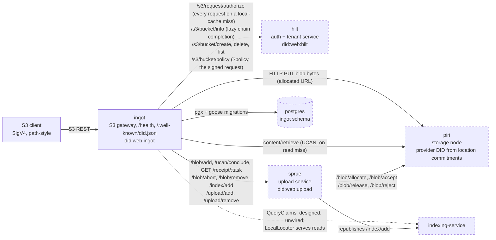

- Ingot never invokes `/blob/accept`: sprue owns accept (and allocate), which
  is why the conclude call carries no space proof.
- Versitygw's root account is disabled (no `WithRootUser` option), so every
  access key resolves through `iam.Service`. A plain (non-`did:key`) access
  key, the shape a root credential would have, is rejected there as
  InvalidAccessKeyId before any hilt round-trip.
- `ListBuckets` is served entirely from hilt; the local `ingot.buckets` table
  backs every other verb.

Cross-references: [`architecture.md` §9](./architecture.md#9-the-system-contract-piri--sprue--indexer)
(the system contract), [§12](./architecture.md#12-implementation-status--postponed-items)
(implementation status).

Sources: `module.go`, `bucketauthority/service.go`, `iam/service.go`,
`s3frontend/policy.go`, `forgeclient/`, `uploader/blob.go`, `blockstore/forge.go`.
Review when these change.

## Package map and interface seams

An edge follows the dependency direction; a label names the interface seam
crossed where one stands between the packages. To add an implementation,
satisfy the seam and rewire it in `module.go`.

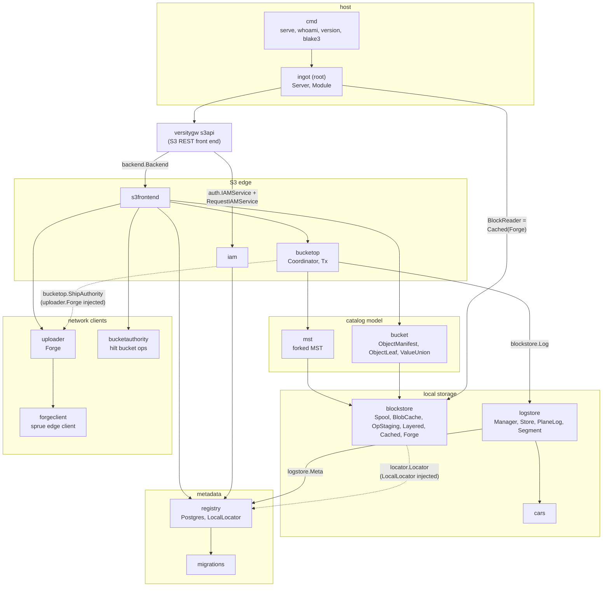

- `registry.Postgres` is one struct satisfying the registry seams
  (`Registry` plus the intent, location, inclusion, blob-ref, GC, multipart,
  and park stores) and `logstore.Meta`.
- `uploader.Forge` is one struct behind `Uploader`, `BodyUploader`,
  `DeferredBodyUploader`, and `BlobRemover`.
- `inmem` (test-only fakes) and `tokenstore` (empty; only the dormant login
  paths would read it) are omitted. `blockstore/locator`'s indexer-backed
  locator compiles but is never injected.
- `iam` and the network tiers never import each other; they meet at
  `internal/reqscope` (the request-scoped proof store, drawn in
  [principals](#principals-and-proof-stores)).

Sources: the `go list` import graph, `module.go`, `server.go`,
`s3frontend/backend.go`. Review on package add/remove or `module.go` provider
changes.

## Two block routes: body blobs and catalog blocks

A write produces two kinds of blocks, and they reach Forge by different
routes. Body blobs travel synchronously, each as its own network object,
before the commit; catalog blocks (MST nodes, manifests, leaf blocks) commit
locally first and ship later, packed into shared CAR segments.

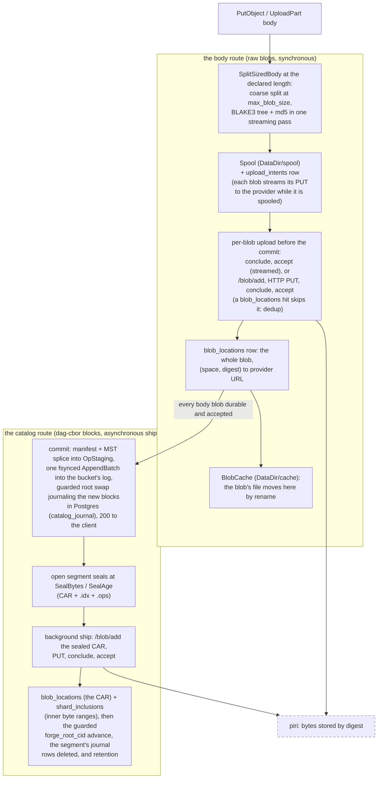

- The `200` means different things per route: body blobs are durable and
  accepted on Forge at ack; the catalog is fsynced locally and journaled in
  Postgres at ack, and becomes durable on Forge only when its segment ships
  (`forge_root_cid` lags `root_cid` until then). The journal is what puts the
  unshipped catalog in any copy of Postgres; shipping the segment deletes its
  rows.
- The ordering is the crash-safety invariant: the catalog route starts only
  after every body blob is durable, so a crash never leaves a catalog entry
  pointing at non-durable data.
- The network unit differs: a body blob is retrieved whole by its own digest
  (a `blob_locations` hit); catalog blocks share a CAR, so a network read
  resolves `shard_inclusions` to a byte range inside the shard.
- Reads mirror the split: `OpenBlob` (bodies) checks local disk (cache,
  then spool) then network, skipping the log; `GetBlock` (catalog) checks
  local disk, log, then network
  (the [GetObject diagram](#getobject-version-resolution-local-tiers-network-retrieval)).
- Removal mirrors it too: bodies are reference-counted
  ([blob lifecycle](#blob-lifecycle-spooled-parked-accepted-released));
  superseded catalog blocks queue for a future collector
  ([catalog GC candidates](#catalog-gc-candidates-what-gets-remembered-for-removal)).
- A body streams: each blob is allocated by size
  and hash function (`/blob/add` with a digest code) and its envelope goes to
  the provider while the spool writes it, so the upload overlaps the body's
  arrival instead of following it. The spool copy still supplies the digest,
  which the put receipt reports and the node checks at accept.
- Multipart parts ride the body route with the conclude deferred (parked);
  the upload's acceptor finishes it
  (the [multipart diagram](#multipart-upload-park-on-write-accept-in-the-background)).

Cross-references: [`architecture.md` §4](./architecture.md#4-the-catalog-layer),
[§5](./architecture.md#5-the-data-layer);
[`logstore/README.md`](../logstore/README.md).

Sources: `s3frontend/object.go` (ingestBody), `s3frontend/stream.go`,
`bucket/sized.go`, `blockstore/spool.go`, `blockstore/blobcache.go`,
`blockstore/staging.go`, `logstore/`, `uploader/forge.go`, `uploader/blob.go`,
`server.go` (newBucketFlushFunc). Review when these change.

## PutObject: spool and upload off the lock, commit under it

All network I/O runs outside the per-bucket lock; the critical section is a
manifest write, an MST splice, one fsynced `AppendBatch`, and a guarded root
swap. A `200` means the body is durable and accepted on the network, not
merely buffered.

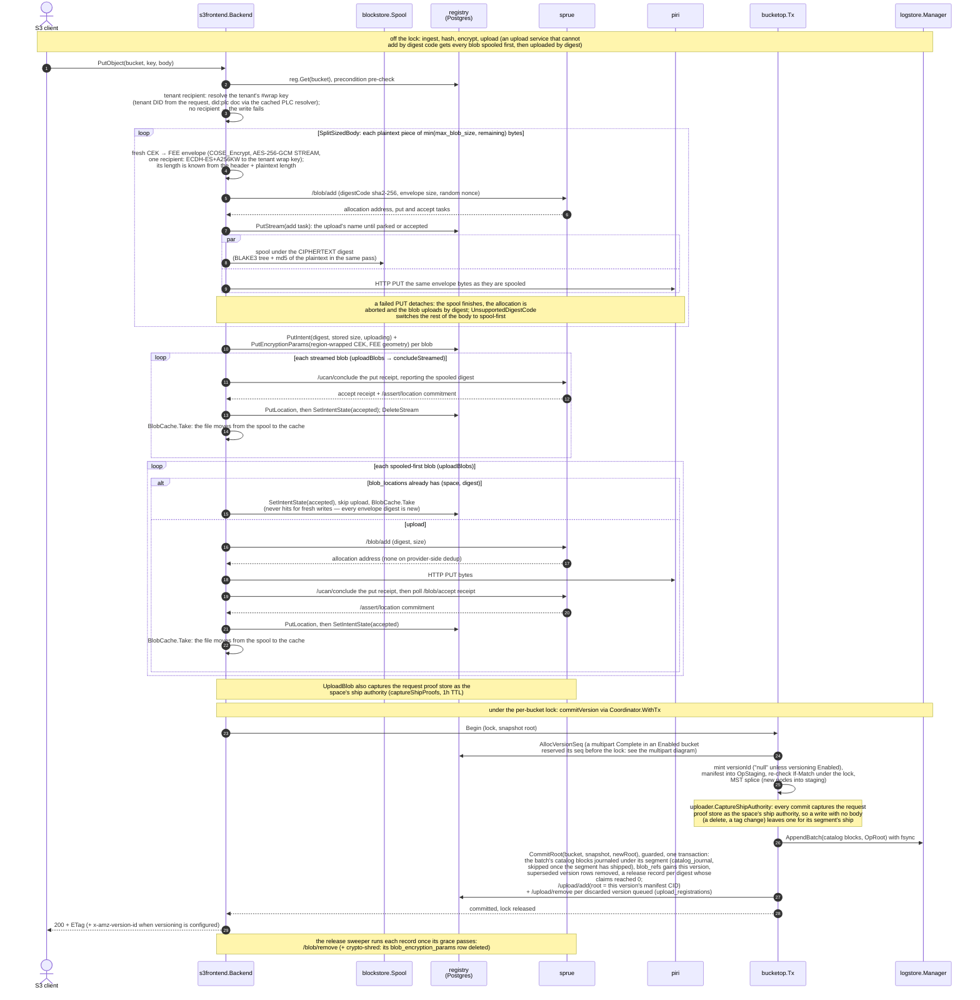

- A request that dies after allocating a streamed blob leaves its
  `blob_streams` row; the stream sweeper (on the release sweeper's tick)
  aborts such an upload by its add task once the row's lease (`touched_at`,
  renewed every 10 minutes by the request that owns it) has gone 30 minutes
  unrenewed, unless its blob was parked, and
  drops the row once the abort lands or the provider reports the blob
  accepted.
- Encryption makes the stored digest a ciphertext digest: **content dedup is
  gone for bodies** (fresh CEK per write ⇒ unique envelope), by design per
  the encryption RFC. Manifest spans, `Body.Size`, the BLAKE3 tree, md5 and ETag stay
  plaintext values; `upload_intents.Size` and `blob_locations.Size` are
  stored (envelope) sizes.
- The envelope's one COSE recipient is the tenant wrap key (kid = the key's
  fingerprint), the RFC's insurance copy: the tenant's private key alone
  recovers the plaintext. The IAM layer stashes the tenant DID from Hilt's
  authorize response on the request; `tenantkey` resolves the `#wrap` key
  from the tenant's did:plc document.
- The supersession rule (which prior version is retained, replaced, or
  discarded) is [`s3-versioning.md`](./s3-versioning.md) §5; the resulting
  storage shape is the [version tree](#per-key-version-storage-manifest-arm-leaf-arm-prev-tree).
- The claim ledger and the zero-claims release are the
  [blob lifecycle](#blob-lifecycle-spooled-parked-accepted-released).
- `CopyObject` runs the same `commitVersion`. Within one space its manifest
  pins the source's digests: no spool, no upload, claims incremented. Across
  spaces (every bucket has its own) the CEK wrap bound to (space, digest)
  rules out sharing, so the source's plaintext streams through the decrypting
  read path into `ingestBody` and the copy gets its own blobs and claims. A
  source bucket owned by another tenant is `AccessDenied` before any key
  lookup (hilt refuses it when authorizing the request; ingot compares the
  tenant on the two bucket rows as well). The copy's ETag is the md5 of its
  bytes even for a multipart source.
- Supersession also records each replaced catalog block for future removal:
  the [catalog GC candidates](#catalog-gc-candidates-what-gets-remembered-for-removal)
  diagram shows every entry path.
- The `/upload/add` is what the upload service counts to report the space's
  object count: one content entry per committed version, keyed by the manifest
  CID. A discarded version retracts, a retained noncurrent one does not, and a
  delete marker registers like any other version — the same set AWS reports for
  `NumberOfObjects`. Best-effort, as the index publication is: the object is
  durable and the response must say so, so a failure logs and the count
  under-reports rather than failing a write that succeeded.
- The write does **not** call the upload service. It queues the change in
  `ingot.upload_registrations` in the same transaction as the root CAS, and the
  registration sweeper (`SweepUploadRegistrations`, every 30s) applies it. The
  count is reporting data, so a Sprue round trip does not belong in a PUT, and
  a Sprue outage delays the count instead of failing writes or losing it.
- The row exists exactly when the version committed, and `seq` replays a key's
  changes in commit order. A sweep spends **two round trips**, not one per
  change: every queued addition in one batch of invocations, then every
  retraction in another. (A batch in ucantone's sense — many invocations, a
  receipt each. `/ucan/conclude` is the other shape, one invocation carrying
  many receipts.)
  Both halves are needed — a container sorts its tokens bytewise, so the
  service may run a batch in any order, and a retraction sharing a batch with
  the addition it retires could overtake it and leave the root counted for
  good. Splitting by op is safe because a root is added by the commit that
  creates the version and retracted by a later one, so an addition always
  carries the lower `seq`.
- A key with a refused change is held whole until it is due again, within the
  sweep and across sweeps, so a later row can never overtake an earlier one.
  Each row carries the delegation chain that authorizes it, captured from the
  request that committed the version, because the sweeper has no request to
  borrow authority from.
- That chain has room to spare — hilt expires its delegation to the gateway at
  the next UTC midnight plus an async overhang, so even a change queued at
  23:59 has hours to be drained in. For the queue that outlasts that, the
  sweeper renews from the space's live authority, which a recent write leaves
  behind. A space that has gone quiet has none, and after
  `uploadRegistrationDeadLetterAfter` attempts the row is **dead-lettered**:
  out of the sweep, and out of the way of its key's later rows. (Nothing to do
  with a parked blob, which is durable and awaiting its accept.) The count is then short by
  that one change rather than frozen for that key, and `dead_letter_reason` records
  why.

Cross-references: [`architecture.md` §7.1](./architecture.md#71-write-single-shot-putobject).

Sources: `s3frontend/object.go` (PutObject, ingestBody, uploadBlobs,
concludeStreamed), `s3frontend/stream.go` (WriteSizedBlob,
SweepStaleStreams), `bucket/sized.go`, `uploader/stream.go`,
`s3frontend/copy.go` (CopyObject, copySourceBucket),
`s3frontend/version.go` (commitVersion, enqueueRegistration),
`s3frontend/uploadsweep.go` (SweepUploadRegistrations), `bucketop/bucketop.go`,
`blockstore/staging.go`, `uploader/blob.go`, `uploader/forge.go`,
`uploader/upload.go`. Review when these change.

## GetObject: version resolution, local tiers, network retrieval

A read resolves the version through the MST, then serves each covering blob
from the first tier that has it: local disk (the cache, then the spool), the
catalog log (catalog blocks only), then the network. Network resolution goes through the local locator
tables, never the indexing-service.

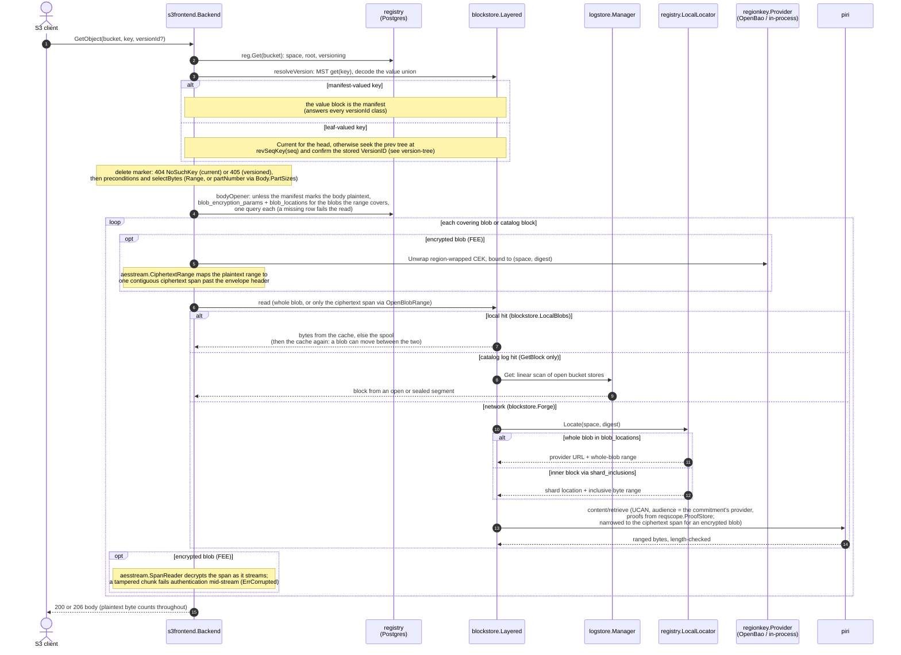

- `OpenBlob` (body blobs) checks local disk then network; only `GetBlock`
  (catalog blocks) consults the log tier, and only `GetBlock` is fronted by
  the `Cached` LRU.
- The indexer-backed locator (`blockstore/locator`) compiles but is never
  injected; `module.go` always wires `LocalLocator`.
- Manifest coordinates are plaintext: blob offsets, `Body.Size`, ETag and
  Content-Length never change with encryption. A blob's digest names the
  stored — for an encrypted blob, ciphertext — bytes; only the per-blob open
  translates between the two.
- The covering blobs come from the manifest's inline list, or from the one
  extent block whose offset range holds the read position (see the version
  storage diagram).
- HEAD needs no decryption at all (every value it reports is a plaintext
  manifest field).

Cross-references: [`architecture.md` §7.4](./architecture.md#74-read-getobject),
[§8](./architecture.md#8-retrieval-addressing-when-bodies-need-a-sharded-dag-index).

Sources: `s3frontend/object.go` (GetObject, HeadObject, selectBytes),
`s3frontend/version.go` (resolveVersion), `s3frontend/decrypt.go`
(bodyOpener, decryptingOpener), `bucket/chunker.go` (BlobRangeOpener),
`blockstore/layered.go`, `blockstore/blobcache.go` (LocalBlobs),
`blockstore/forge.go` (doRetrieve), `blockstore/cache.go`,
`registry/locallocator.go`, `logstore/manager.go` (Get). Review when these
change.

## Multipart upload: park on write, accept in the background

Parts upload to the provider at `UploadPart` and park there (durable,
unaccepted). Each upload's acceptor concludes its parked parts in batches
while the client is still uploading, so `Complete` waits only for the last
few and its cost stays flat as the part count grows.

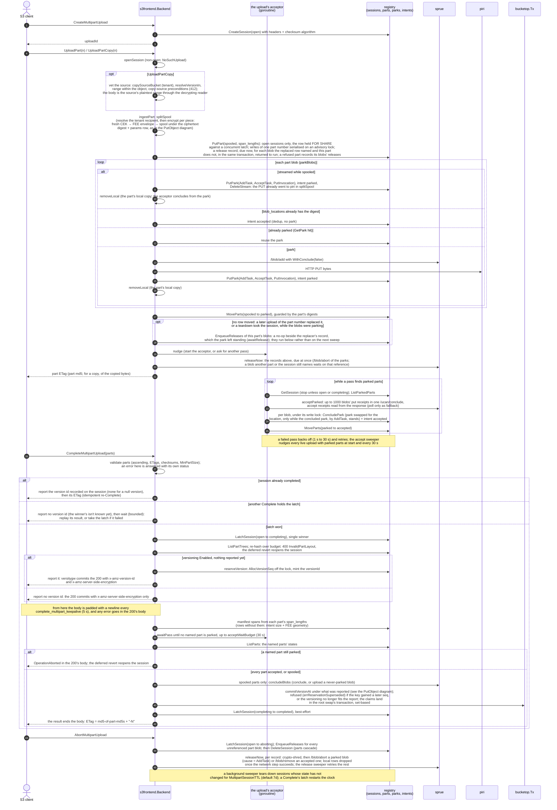

- A part re-upload and an abort record a release for every blob of theirs
  that is not still live in the session; the release itself decides whether
  the blob is free to go — a claimed digest drops the record (`CountClaims`),
  and one a part of an in-flight session references waits
  (`CountLivePartRefs`, checked first: a Complete claims before it leaves
  'completing'). A commit's claim publishes the blob's upload intent, so
  the reap of a retained session releases only what was never committed.
- A release can take a blob while the acceptor concludes it. The provider
  refuses whichever of accept and abort comes second, and the release drops
  the park row before anything else, so `ConcludePark` finds no park and the
  acceptor records nothing for a blob a release took. `ConcludePark`
  matches the park's `/blob/add` task, so a later park of the same bytes
  stays for its own conclude.
- The acceptor never cancels a release record (`ReleasingDigests`, read
  only); a part holding such a blob goes back to `spooled` for Complete.
  Each pass runs under `acceptPassTimeout`.
- No release runs while its blob's conclude is in flight: sprue registers
  an accepted blob only when it answers, so an earlier remove would miss it.
  A teardown waits for the acceptor's pass in flight (`quiesceAcceptor`)
  before it records releases; any other release defers while the blob is
  marked (`markConcluding`, held 2 min past a failed conclude) and runs from
  the release sweeper.
- A part is written only while its session is open, in the statement that
  checks the state; a teardown that took the session refuses it, and the
  upload records releases for the blobs it had spooled.
- A never-parked blob at Complete falls back to a full synchronous
  `UploadBlob`, after rechecking for a park under the blob's lock: an
  UploadPart still parking the blob when Complete classified it holds that
  lock, and its park is concluded rather than allocated beside.
- Complete reports its response headers through versitygw's
  `CompleteMultipartUploadReportingHeaders` before it accepts the parts,
  and the response commits to 200 at the report, as S3's does. A reserved
  version id is binding, and a Complete that reported none commits only a
  null version, so the client always learns the version it created
  ([`s3-versioning.md`](./s3-versioning.md) §5.1).

Cross-references: [`architecture.md` §7.2](./architecture.md#72-multipart),
[§7.3](./architecture.md#73-the-session-latch-the-abortcomplete-race).

Sources: `s3frontend/multipart.go` (all verbs, ingestPart, parkBlobs,
recordStreamedPark, acceptRequested, acceptParked, recordConcluded,
concludeBlobs, enqueuePartReleases, SweepStaleMultipartSessions),
`s3frontend/version.go` (reserveVersion, commitVersionAt),
`s3frontend/acceptor.go`, `s3frontend/stream.go`,
`s3frontend/object.go` (runRelease, executeRelease),
`s3frontend/uploadpartcopy.go`, `registry/stores.go`,
`server.go` (startMultipartSweeper, startAcceptSweeper). Review when these change.

## Part states: the acceptance queue

A part row's `state` is the upload's acceptance queue. Every move is a
guarded update that also matches the part's `blob_digests`, so a request
never moves a row a later upload of the same part number replaced.

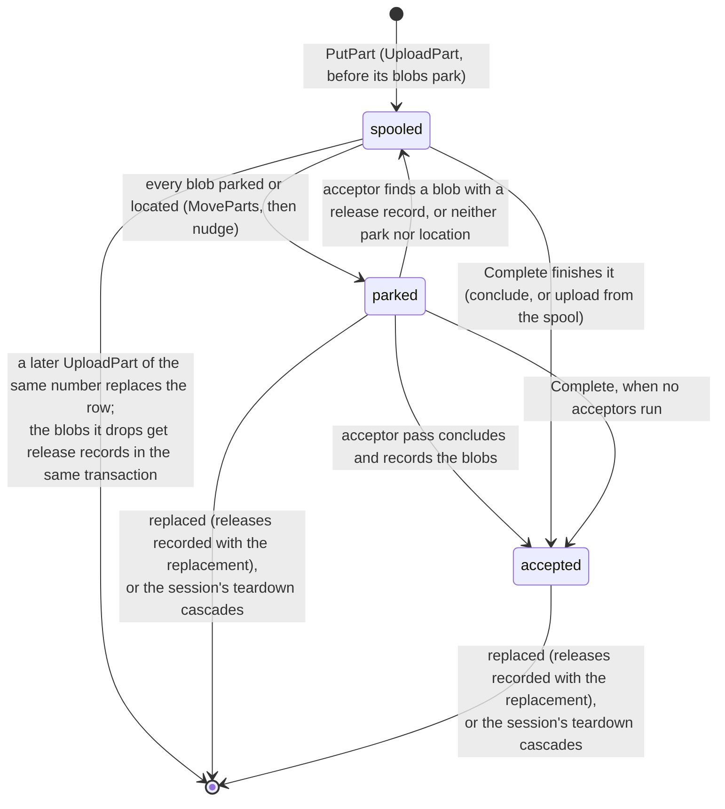

- `spooled` is the state of a part whose request is still parking its
  blobs, or died doing so. The acceptor never takes it; Complete does.
- A request whose `spooled` row is replaced while it parks moves no row to
  `parked`. The releases the replacement recorded stand: a part's park
  leaves a pending release of its digest to the part row, which defers it
  while the row stands and lets it run once the row is replaced, so the
  blobs go even if the request dies there. The request runs them itself
  when it can, rather than leave them to the next sweep.
- Complete requires every part it names to be `accepted` before the commit:
  it waits until none of them is queued (parts it omits are not waited
  for), finishes `spooled` parts itself, and answers a part still `parked`
  with a 409 that botocore clients treat as final. A failed pass accepts
  every part of its batch but those holding a failed blob.
- Rows from before migration 00030 are `parked` or `accepted` and have no
  `span_lengths`; Complete derives their lengths per blob.

Sources: `registry/stores.go` (Part* consts, MoveParts, ListParkedParts,
ListUploadsWithParkedParts), `registry/stores_postgres.go`,
`s3frontend/acceptor.go`, `s3frontend/multipart.go` (ingestPart,
acceptRequested), `migrations/sql/00030_part_accept_queue.sql`. Review when
these change.

## Session states and the Complete/Abort latch

The latch is one guarded update: `UPDATE multipart_sessions SET state = $3
WHERE upload_id = $1 AND state = $2`; exactly one caller sees
`RowsAffected == 1`.

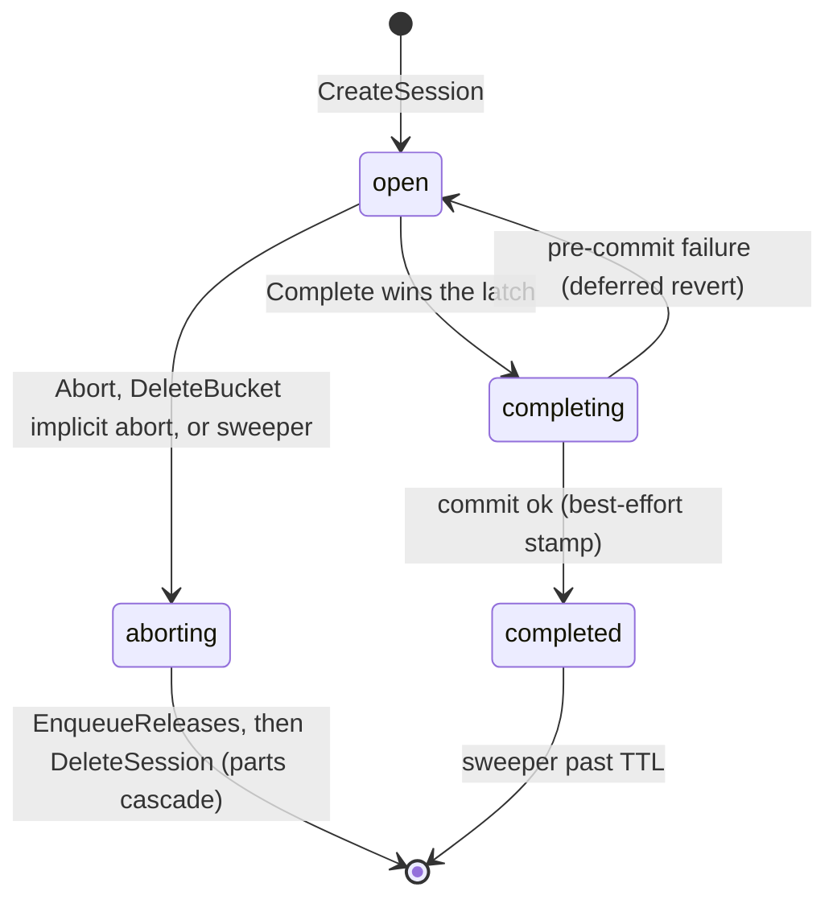

- A Complete that loses the latch reports no version id, then waits
  (bounded) for the winner's terminal state: `completed` replays the ETag
  and version id the winner recorded on the session; `aborting` or a
  vanished row is `NoSuchUpload`; a winner still running past the wait
  budget is `OperationAborted`, inside the 200's body since the headers
  have gone out. A winner that fails reopens the session, and the waiting
  Complete may then take the latch; in an Enabled bucket its commit is
  refused, since it reported no id, and the client's retry reports one.
- `ListParts` and `Abort` reject any non-`open` session as `NoSuchUpload`;
  `Complete` alone accepts `completed`, for idempotency.
- The sweeper also reaps rows stuck in `completing` or `aborting` past the
  TTL.

Sources: `s3frontend/multipart.go`, `registry/stores_postgres.go`
(LatchSession). Review when these change.

## Blob lifecycle: spooled, parked, accepted, released

Dedup stores bytes once; the claim ledger lets them be deleted once. Intents
track the disk-and-network state of each digest; `blob_refs` counts which
versions still reference it.

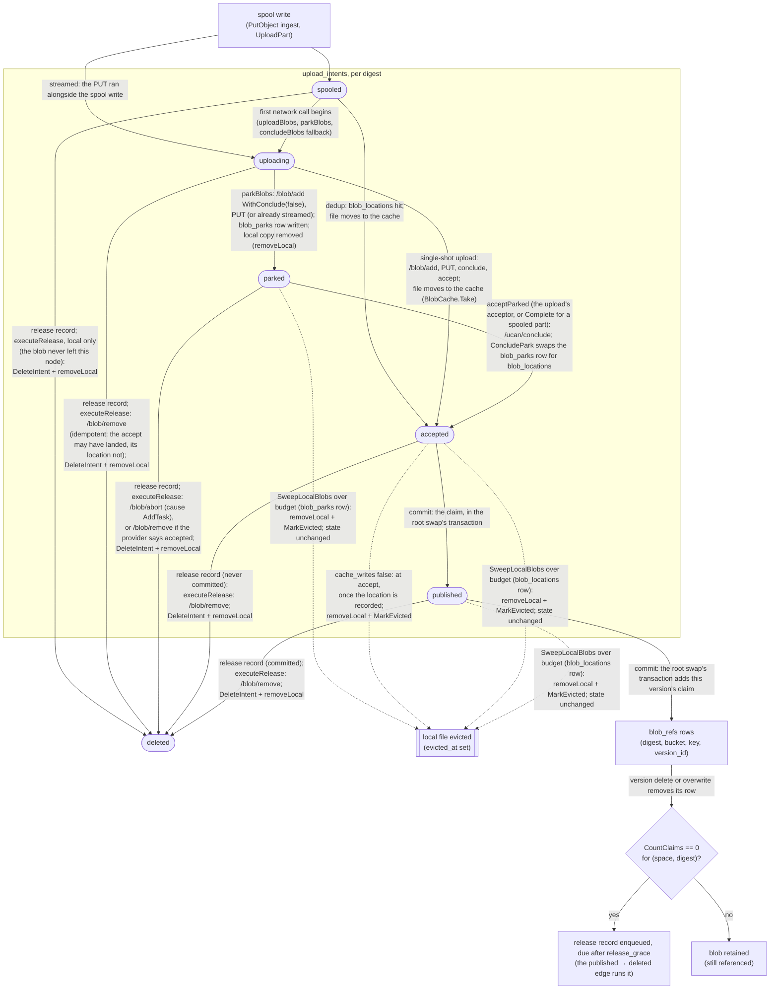

- `published` is written with the blob's first reference claim and never
  changes until the blob's release, which removes the local copy and the
  intent as it does for a never-committed blob. `blob_parks` is a
  presence machine (a row exists while a conclude is owed), not a state
  column.
- A blob's file lives in the spool until the provider holds it, then moves
  to the cache: once its location and `accepted` state are both recorded,
  by rename (`BlobCache.Take`). A failed move leaves it in the spool. With
  `cache_writes: false` the copy is removed at that point instead, and the
  intent gains `evicted_at`.
- Eviction (the dotted edges) is orthogonal to the state: `SweepLocalBlobs`
  runs every 30s and, when the spool and cache together are over
  `local_blob_max_bytes`, removes the local files of blobs the provider
  already holds (a location row for `accepted` and `published`, a park row
  for `parked`), oldest state change first, down to 90% of the budget,
  passing over blobs inside `cache_min_residency` or `cache_read_retention`
  unless usage stays over budget without them (then evicting inside the
  windows only down to the budget): from
  the cache, or from the spool for a blob whose move never happened. The
  intent keeps its row and state and gains `evicted_at`; reads fall through
  to the network tier. `spooled` and `uploading` files are never evicted.
  The parked-part drop at UploadPart marks `evicted_at` the same way. A
  committed blob's release removes its local copy with the intent; once at
  startup, the released pass does the same for `published` intents nothing
  names any more (no location, claim, pending release or live part), left
  by versions whose releases kept the copy.
- Digests present in both the old and new version sets never churn: the new
  generation's claim lands before the old one's drops in the same
  transaction, so the digest keeps a claim throughout and no release is
  recorded.
- Parked-blob reclamation is guarded: a digest live in another session, part,
  or committed object is left alone.
- A same-space copy pins the source's body: its claims are pins
  (`registry.RootCommit.Pins`), each written only while the space still
  holds a claim on the digest, under its lock, so a copy racing the source's
  delete and release fails with NoSuchKey instead of claiming a blob about
  to go.

Cross-references: [`architecture.md` §5](./architecture.md#5-the-data-layer),
[`s3-versioning.md`](./s3-versioning.md) §8.

Sources: `registry/stores.go` (state consts, ListEvictable, ListReleasedPublished), `s3frontend/object.go`
(ingestBody, addClaims, dropClaims), `s3frontend/localblob_sweep.go` (SweepLocalBlobs),
`s3frontend/localblobs.go` (cacheHeld, removeLocal),
`s3frontend/multipart.go`
(parkBlobs, acceptParked, recordConcluded, concludeBlobs, enqueuePartReleases),
`s3frontend/acceptor.go`, `s3frontend/object.go`
(runRelease, executeRelease), `uploader/blob.go` (UploadBlob,
AbortBlob, RemoveBlob). Review when these change.

## Per-key version storage: manifest arm, leaf arm, prev tree

Every catalog value block is a keyed union naming its own format. A key holds
its manifest directly until its first retained supersession, then gains an
`ObjectLeaf` and keeps it for the rest of its life.

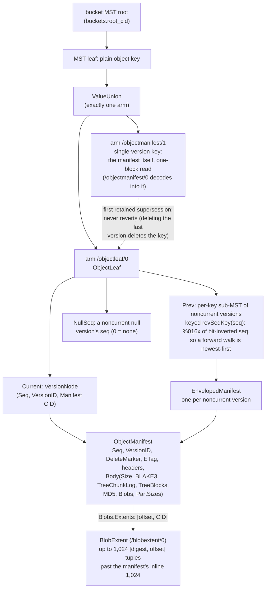

- At most one null version exists per key; it may sit anywhere in the stack,
  and `NullSeq` locates (and lets a new null evict) a noncurrent one.
- The version token is a ULID whose low bytes embed the seq, but the embedded
  seq is only a locator hint: resolution always confirms the stored
  `VersionID`.
- Deleting the current version promotes the prev-tree head into a new leaf
  (clearing `NullSeq` when the promoted seq was the null); deleting the last
  version deletes the key.
- The bucket versioning state itself is three values with one guarded SQL
  update: `unversioned` moves to `enabled` or `suspended`, which then toggle;
  there is no path back to `unversioned`.
- Blocks this tree sheds (replaced leaf blocks, discarded manifests) are
  recorded for future removal; the entry paths are the
  [catalog GC candidates](#catalog-gc-candidates-what-gets-remembered-for-removal)
  diagram.

Cross-references: [`s3-versioning.md`](./s3-versioning.md) (the full design:
value union §2.1, prev tree §2.2, token §3, write rule §5, deletes §7);
[`architecture.md` §4](./architecture.md#4-the-catalog-layer) keeps the ASCII
manifest figure this complements.

Sources: `bucket/leaf.go`, `bucket/manifest.go`, `s3frontend/version.go`
(mintVersionID, revSeqKey, commitVersion, deleteVersionScoped). Review when
`bucket/` types change (and re-run `make gen`).

## Catalog GC candidates: what gets remembered for removal

`gc_candidates` is the memory of the catalog collector to come: every write
that supersedes a catalog block records that block's CID here, inside the
commit critical section, so nothing the tree sheds is ever forgotten. Nothing
consumes the table yet.

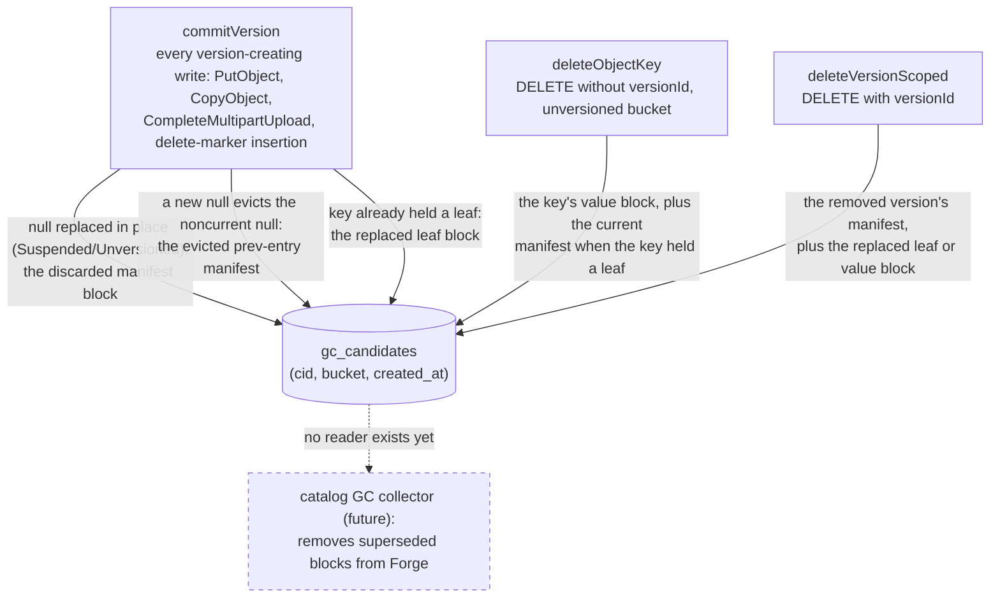

- Recording is mandatory, never best-effort: the inserts run inside the
  per-bucket commit closure, so a failed insert fails the whole write before
  the root swap.
- A retained supersession queues only the replaced **leaf block**; the old
  manifest is not queued because it lives on as a prev-tree entry. Only
  blocks nothing references anymore land here.
- As built, the table holds superseded **value blocks** (manifests and leaf
  blocks). Interior MST path nodes rewritten by a splice are not recorded;
  [`architecture.md` §4](./architecture.md#4-the-catalog-layer) scopes the
  eventual collector to those as well.
- The body bytes a removed version referenced are handled separately, by the
  claim ledger in the
  [blob lifecycle](#blob-lifecycle-spooled-parked-accepted-released):
  `gc_candidates` remembers catalog blocks, `blob_refs` counts body blobs.

Cross-references: [`architecture.md` §4](./architecture.md#4-the-catalog-layer),
[`s3-versioning.md`](./s3-versioning.md) §7.

Sources: `s3frontend/version.go` (commitVersion supersession,
deleteVersionScoped), `s3frontend/object.go` (deleteObjectKey),
`registry/stores_postgres.go` (AddGCCandidate). Review when these change.

## Principals and proof stores

The agent signs every outbound invocation, but the authority to act on a
space arrives per request: hilt re-delegates the access key's grant to the
agent, the IAM layer caches it per access key, and `internal/reqscope`
carries it into the write and read paths.

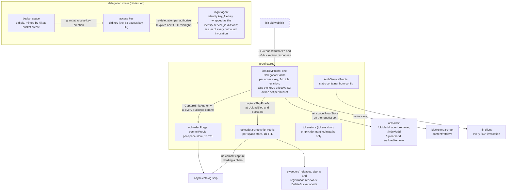

- The piri provider DID is never configured: retrieval audiences come from
  the `/assert/location` commitment each read resolves.
- Every authenticated S3 request carries a proof store: versitygw's root
  account is disabled, so no access-key auth path skips the hilt-backed IAM
  lookup. `/health` and the DID document are outside the S3 auth chain, and a
  rejected access key never receives one.
- Every write captures the ship authority when it commits, so a segment,
  sealed seconds after its writes, ships under a fresh capture. That capture
  is kept apart from the upload's: hilt grants each catalog-changing
  operation the ship's commands, but a narrower key's grant (tagging,
  retention) lacks the release, abort and registration commands the
  upload's capture also serves. The ship uses the commit's capture only when
  it holds a `/blob/add` chain for the space (an older key's grant, or an
  expired or revoked delegation, may not), and the upload's otherwise. Both
  last an hour and live in memory: a segment whose ship keeps failing past
  that, or across a restart, has no authority until the bucket's next
  write.
- Each access key gets its own `DelegationCache`, so a proof chain can never
  assemble across keys.
- The same store holds the effective S3 action set hilt reported for the key
  on each bucket, expiring with the keys and the tenant (next UTC midnight
  plus clock skew). One invalidation therefore drops the chains and the set
  together. The set is what the fast path enforces: several S3 actions map to
  the same Forge commands, and `s3:PutObject`'s commands are a superset of
  `s3:GetObject`'s, `s3:ListBucket`'s and `s3:AbortMultipartUpload`'s, so a
  chain probe alone would let a put-only key read and abort on the bucket, or
  read a copy's source.
- A copy's source and the headers that add a permission to a write (a lock
  or tags on the version it creates) are decided from headers, and a
  DeleteObjects on its body, which iam attaches for the operations hilt
  names (`Operation.ReadsBody`) and no other. Hilt's `RequirementsFor`
  refuses a header the signature does not cover or a body it does not bind,
  as hilt itself does, so the fast path decides nothing from such a
  request: it goes to hilt, which refuses it as `UnsignedHeader` or
  `InvalidBody`.

Cross-references: [`architecture.md` §9](./architecture.md#9-the-system-contract-piri--sprue--indexer).

Sources: `iam/service.go`, `iam/keyproofs.go`, `iam/proofcache.go`,
`internal/reqscope/reqscope.go`, `uploader/forge.go` (shipProofs,
captureShipProofs, CaptureShipAuthority), `bucketop/bucketop.go` (Tx.Commit),
`module.go`, `config/config.go` (auth_service fields).
Review when these change.

## Request authorization and proof capture

Every request is authorized against hilt (or its cached delegations), and
the proofs captured here are what the rest of the request spends. Versitygw's
root account is disabled, so no access key bypasses this path. The bucket
policy operations (GET, PUT and DELETE on `/{bucket}?policy`) take it too,
through versitygw's own controllers; the backend (`s3frontend/policy.go`)
then forwards the signed request to `/s3/bucket/policy`, where hilt
authenticates and authorizes it again and keeps the document.

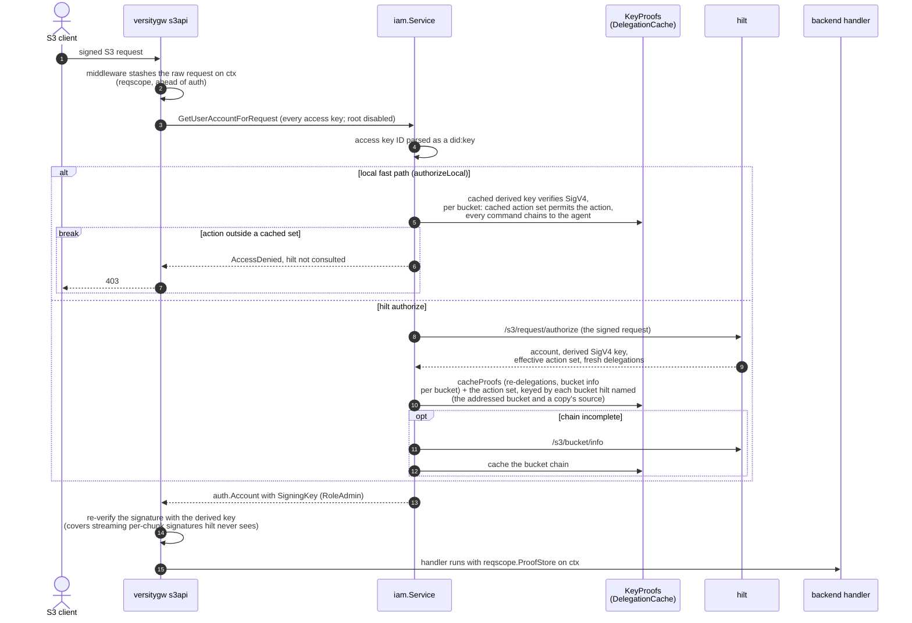

- The fast path has three outcomes: authorized, refused, or undecided. It
  refuses only on a cached action set that excludes the action a bucket
  needs — hilt's own answer for that key and bucket, so re-asking would
  repeat it (access keys are immutable; a deleted key's revocations clear
  the store). Everything else undecided (no cached set for a bucket, an
  expired one, an operation that maps to no Forge command) goes to hilt,
  whose response refills the caches.
- `RoleAdmin` is deliberate: authorization already happened (at hilt or the
  fast path), so versitygw's role and ACL layers must defer entirely.
- Authorize failures map to S3 errors in `mapAuthError`; unrecognized errors
  stay 500-class on purpose.
- The signing key never leaves hilt as a secret: ingot receives a derived
  SigV4 key per request (the versitygw fork's `auth.Account.SigningKey`).
- A policy document reaches hilt only after versitygw's PutBucketPolicy
  controller has validated its AWS shape; `iam.Service.GetUserAccount`
  answers that validation's principal lookups for any well-formed user ARN.
  GetBucketPolicy forwards only a signed GET ?policy: versitygw's own access
  checks call it too and get the stub answer, so versitygw never evaluates a
  policy. A hilt rejection renders through the same `mapAuthError` mapping;
  a gateway middleware (`policyHeaders`) adds the response ETag the backend
  leaves in a reqscope holder, and a GET's JSON content type.

Sources: `iam/service.go` (GetUserAccountForRequest, authorizeLocal,
cacheProofs, mapAuthError), `iam/proofcache.go` (PutPermissions, Permits),
`server.go` (buildS3API middleware, policyHeaders), `s3frontend/policy.go`.
Review when `iam/`, `s3frontend/policy.go` or the hilt client changes.

## Postgres schema as migrated

Everything relational lives in the `ingot` schema; manifests and MST nodes
are content-addressed blocks in the catalog log, not rows, apart from the
catalog journal's copy of those not yet shipped. Attributes here
are trimmed to keys, states, and the columns other diagrams reference; the
full DDL is `migrations/sql/`.

```mermaid
erDiagram
    buckets {
        text name PK
        bytea root_cid "committed MST root"
        bytea forge_root_cid "root durable on Forge"
        text space "Forge space DID"
        text tenant "owning tenant DID"
        text versioning "unversioned, enabled, suspended"
        text encryption "AES256, none; NULL = unconfigured, encrypts"
        bigint next_version_seq
    }
    segments {
        bigint seq PK "from segment_seq"
        text plane "'data' arm is dead"
        text state "open, sealed"
        text bucket
        bytea sha256
        bigint shipped_at
        bytea index_digest
        bigint retired_at
    }
    segment_op_roots {
        bigint seq PK, FK
        int seq_within PK
        text bucket
        bytea root_cid
    }
    catalog_journal {
        bigint seq PK "segment the block went into"
        bytea cid PK
        text bucket FK
        bytea data "the block, until its segment ships"
        timestamptz created_at
    }
    blob_refs {
        bytea digest PK
        text bucket PK
        text object_key PK
        text version_id PK
        text space "claim index (space, digest)"
    }
    upload_intents {
        text space PK "the upload's space: one file, an intent per space"
        bytea digest PK
        text local_path
        bigint size
        text state "spooled, uploading, parked, accepted, published (claimed by a commit)"
        text bucket
        timestamptz updated_at "last state change: the budget pass evicts oldest first"
        timestamptz evicted_at "set once the local copy is removed (sweeper or parked-part drop)"
    }
    blob_locations {
        text space PK
        bytea digest PK
        text provider "provider DID"
        text url
        bigint size
    }
    blob_encryption_params {
        text space PK
        bytea digest PK "ciphertext blob multihash"
        bytea region_wrapped_cek "never the raw CEK; deleting the row crypto-shreds the blob"
        text region_key_version
        bigint header_len "the ciphertext starts here"
        bytea aad "COSE Enc_structure; its protected header holds the base nonce and chunk size"
    }
    shard_inclusions {
        text space PK
        bytea digest PK "inner block multihash"
        bytea shard_digest
        bigint range_start
        bigint range_end "inclusive"
    }
    blob_parks {
        text space PK "the allocation's space"
        bytea digest PK
        bytea add_task
        bytea accept_task
        bytea put_invocation
        bigint size
    }
    blob_streams {
        bytea add_task PK "an upload allocated by digest code"
        text space
        text bucket
        bigint size
        timestamptz created_at "when the sweeper stops retrying the abort"
        timestamptz touched_at "the owning request's lease, renewed while it runs; the stream sweeper's clock"
    }
    multipart_sessions {
        text upload_id PK
        text bucket
        text space "the bucket's space, required: the subject of every release of the session's blobs, never resolved from the bucket name"
        text object_key
        text state "open, completing, aborting, completed"
        timestamptz state_changed_at "the sweeper's clock"
        boolean plaintext "store parts as received; decided at create"
        text checksum_algorithm
    }
    multipart_parts {
        text upload_id PK, FK
        int part_number PK
        bytea etag_md5
        bytea blob_digests "ordered array"
        bigint span_lengths "each blob's span in the object, bytes before encryption (digests are of the stored blob); NULL before 00030"
        text checksum
        text state "spooled, parked, accepted: the acceptor's queue"
    }
    multipart_part_trees {
        text upload_id PK, FK
        int part_number PK, FK
        bigint tree_offset "object offset the part's BLAKE3 tree was hashed at (assumed by UploadPart)"
        smallint chunk_log "block size of blocks, base-2 exponent of chunks"
        bytea nodes "the part's aligned subtrees (blake3tree.EncodeSubtrees)"
        bytea blocks "the part's blocks at chunk_log; up to 320 KiB for a 5 GiB part"
        bytea head "bytes before the part's first chunk boundary (< 1 KiB)"
        bytea tail "bytes after its last chunk boundary (< 1 KiB)"
        bytea root "the part's own BLAKE3 hash, when hashed at offset 0"
    }
    blob_release_intents {
        text space PK
        bytea digest PK
        timestamptz not_before "earliest execution: claim drop + grace, or at once for a part blob"
        timestamptz started_at "set under the claim-key lock once the release owns the blob; a reusing write cancels an unstarted record or waits out a started one"
    }
    gc_candidates {
        bytea cid PK "superseded MST node"
        text bucket
    }
    upload_registrations {
        bigint seq PK "commit order"
        text bucket FK
        text object_key
        text space
        bytea root "the version's manifest CID"
        text op "add, remove"
        timestamptz next_at "the sweeper's clock"
        timestamptz dead_lettered_at "set once retrying stops"
    }
    revocation_cursor {
        boolean id PK "single-row latch"
        timestamptz recorded_at "resume point in the revocation stream"
    }

    segments ||--o{ segment_op_roots : "ON DELETE CASCADE"
    multipart_sessions ||--o{ multipart_parts : "ON DELETE CASCADE"
    multipart_parts ||--o| multipart_part_trees : "ON DELETE CASCADE; deleted by Complete once the object commits"
    buckets ||--o{ upload_registrations : "ON DELETE CASCADE"
    buckets ||--o{ catalog_journal : "ON DELETE CASCADE"
    segments ||..o{ catalog_journal : "by seq, deliberately no FK"
    buckets ||..o{ segments : "by bucket name, no FK"
    buckets ||..o{ blob_refs : "by bucket name, no FK"
    blob_locations ||..o{ shard_inclusions : "by shard_digest"
    blob_locations ||..o| blob_encryption_params : "by (space, digest), deliberately no FK"
    multipart_parts ||..o{ blob_parks : "digests in blob_digests"
    multipart_parts ||..o{ blob_release_intents : "teardown and supersede records, by digest"
```

- The five solid relationships are the schema's only real foreign keys;
  dashed ones are soft joins the code performs. `revocation_cursor` stands
  alone.
- `catalog_journal` has no foreign key to `segments` on purpose: when a
  segment's CAR is missing from disk, recovery deletes its row if it was open
  (and retires it if it was sealed), and after a lost disk the journal rows
  are what that segment is rebuilt from.
- `gc_candidates` is write-only (no reader exists yet; its entry paths are the
  [catalog GC candidates](#catalog-gc-candidates-what-gets-remembered-for-removal)
  diagram); `segments.plane`
  still CHECK-allows the deleted `data` arm; `multipart_parts.accepted` is a
  CHECK arm no code writes.
- Session rows also carry the passthrough HTTP headers and checksum columns
  Complete writes into the manifest; intent and location rows carry
  timestamps. See the DDL for the full column lists.

Cross-references: [`architecture.md` Appendix C](./architecture.md#appendix-c--postgres-schema-the-ingot-schema)
(the annotated DDL).

Sources: `migrations/sql/*.sql`. Review whenever a migration is added.

## DeleteBucket teardown order

Teardown crosses every seam in order: prove the bucket empty, commit its
root empty, unwind in-flight multipart, quiesce the log, release every
network registration, then delete at hilt and locally.

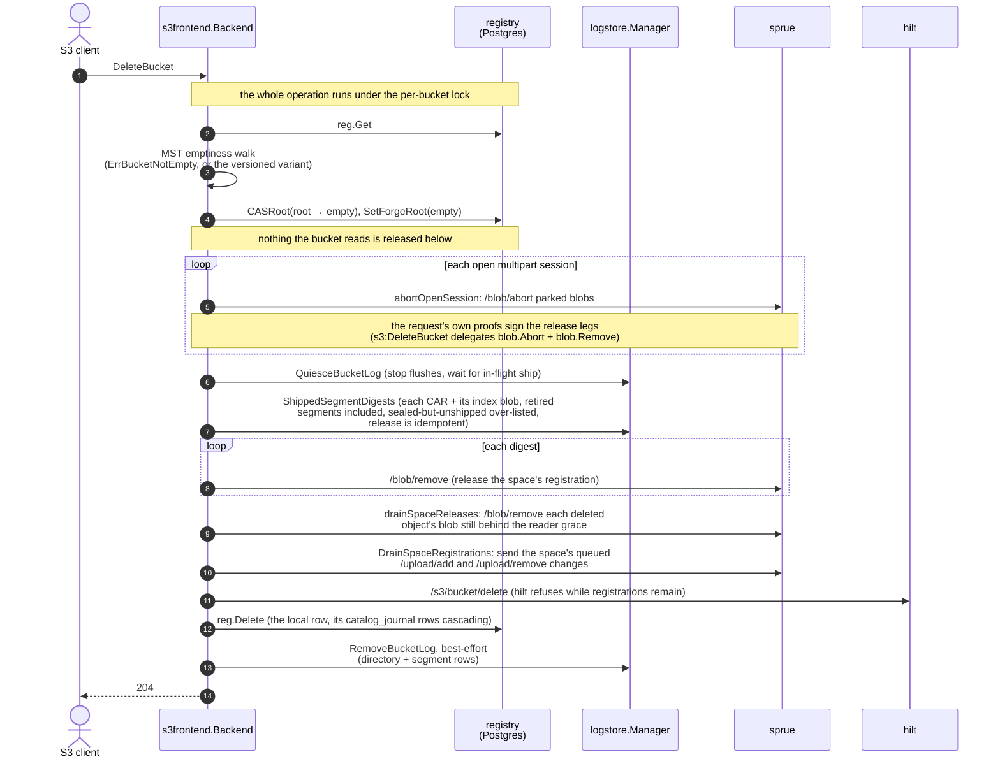

- The log seams (`QuiesceBucketLog`, `ShippedSegmentDigests`,
  `RemoveBucketLog`) are type-asserted on `blockstore.Log`: a plain `Store`
  without them silently no-ops, which is the trap this diagram documents.
- A failure after the root is committed empty (hilt refusing, a release
  erroring) leaves the bucket functional: it lists empty, the closed store
  reopens lazily on the next write, and a retried delete starts over.

Sources: `s3frontend/bucket.go` (DeleteBucket), `s3frontend/multipart.go`
(abortOpenSession), `s3frontend/object.go` (drainSpaceReleases),
`s3frontend/uploadsweep.go` (DrainSpaceRegistrations), `logstore/manager.go`.
Review when these change.

## Package-to-diagram map

The review table for changes: find the package you touched, re-check the
listed diagrams (each diagram's `Sources:` footer names its exact files).

| Package / file | Diagrams to review |
|---|---|
| `s3frontend/object.go` | put, get, blob-lifecycle, version-tree, gc-candidates |
| `s3frontend/version.go` | put, get, multipart, blob-lifecycle, version-tree, gc-candidates |
| `s3frontend/multipart.go` | multipart, part-states, multipart-states, blob-lifecycle |
| `s3frontend/acceptor.go` | multipart, part-states, blob-lifecycle |
| `s3frontend/stream.go` | put, multipart, block-routes, blob-lifecycle |
| `s3frontend/bucket.go` | context, delete-bucket |
| `bucketop/` | put, get, delete-bucket, packages, principals |
| `blockstore/` | get, packages, block-routes; `forge.go` also context, principals |
| `registry/` | schema, get, blob-lifecycle, logstore-pipeline |
| `logstore/` | logstore-pipeline, segment-states, get, block-routes, delete-bucket |
| `uploader/`, `forgeclient/` | context, put, multipart, principals, logstore-pipeline, block-routes |
| `iam/`, `internal/reqscope/` | principals, authorize, context |
| `bucket/`, `mst/` | version-tree, put, get |
| `migrations/sql/` | schema, plus any state diagram naming a changed CHECK |
| `module.go`, `server.go`, `config/` | packages, context, logstore-pipeline; `server.go` also authorize and multipart |
| `s3frontend/policy.go` | context, authorize |
