# Ingot diagrams

These diagrams draw ingot **as it is built in this tree**. Where the code
deliberately stops short of the target architecture, the divergence appears as
a labeled annotation at the exact point (a dotted edge in a flowchart, a Note
in a sequence); the target itself lives in [`architecture.md`](./architecture.md).
Service names are lowercase (`ingot`, `sprue`, `piri`, `hilt`,
`indexing-service`), and external services are drawn dashed and opaque with
their contracts on the edges, so the diagram sets piri, sprue, and hilt
publish later can join on the same nodes. Each diagram ends with a `Sources:`
line naming its ground-truth files, and the
[package-to-diagram table](#package-to-diagram-map) at the bottom maps a code
change to the diagrams to re-check. The maintenance rule lives in
[`CLAUDE.md`](../CLAUDE.md).

| id | Diagram | Shows | Home |
|---|---|---|---|
| `context` | [System context](#system-context-services-and-contracts) | every service ingot talks to, and the contract on each edge | here |
| `packages` | [Package map](#package-map-and-interface-seams) | internal packages and the interface seams between them | here |
| `block-routes` | [Two block routes](#two-block-routes-body-blobs-and-catalog-blocks) | how body blobs and catalog blocks travel to Forge by different paths | here |
| `put` | [PutObject](#putobject-stream-and-upload-in-the-request-commit-on-the-bucket-queue) | the write path: ingest and upload in the request, commit on the bucket queue | here |
| `get` | [GetObject](#getobject-version-resolution-local-tiers-network-retrieval) | version resolution, tier fallthrough, network retrieval | here |
| `multipart` | [Multipart upload](#multipart-upload-park-on-write-accept-in-the-background) | park at UploadPart, accept in the background, Complete's wait, abort unwind | here |
| `part-states` | [Part states](#part-states-the-acceptance-queue) | the part rows as the upload's accept queue | here |
| `multipart-states` | [Session states](#session-states-open-and-completed) | the session state machine, one change per upload at a time | here |
| `blob-lifecycle` | [Blob lifecycle](#blob-lifecycle-uploading-parked-accepted-released) | intent states and the claim ledger gating deletion | here |
| `version-tree` | [Per-key version storage](#per-key-version-storage-manifest-arm-leaf-arm-prev-tree) | the value union, the leaf, the prev tree | here |
| `gc-candidates` | [Catalog GC candidates](#catalog-gc-candidates-what-gets-remembered-for-removal) | every path that records a superseded catalog block for removal | here |
| `principals` | [Principals and proof stores](#principals-and-proof-stores) | every DID in play and which store proves what | here |
| `authorize` | [Request authorization](#request-authorization-and-proof-capture) | the per-request hilt authorize flow and proof capture | here |
| `schema` | [Postgres schema](#postgres-schema-as-migrated) | the `ingot` schema's tables and joins | here |
| `delete-bucket` | [DeleteBucket teardown](#deletebucket-teardown-order) | the teardown ordering across every seam | here |
| `logstore-pipeline` | Catalog pipeline | append, seal, ship, guarded root advance | [`logstore/README.md`](../logstore/README.md#write-path) |
| `segment-states` | Segment lifecycle | open, sealed, shipped, retired, recovery | [`logstore/README.md`](../logstore/README.md#segment-lifecycle) |

## System context: services and contracts

Ingot is an S3 gateway over the Forge network: versitygw serves S3 REST
(`:8080` by default; `:80` in the smelt stack, where `did:web:ingot` resolves
to the listener's `/.well-known/did.json`), hilt authorizes requests and owns
tenancy, sprue brokers every blob
operation, and piri stores and serves the bytes. The indexing-service read
path is designed but unwired; a local locator (over `blob_locations` and
`shard_inclusions`) serves reads instead.

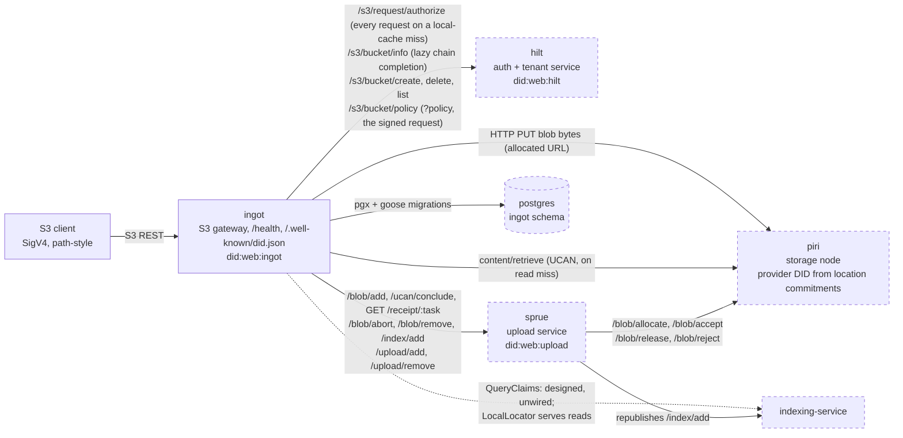

- Ingot never invokes `/blob/accept`: sprue owns accept (and allocate), which
  is why the conclude call carries no space proof.
- Versitygw's root account is disabled (no `WithRootUser` option), so every
  access key resolves through `iam.Service`. A plain (non-`did:key`) access
  key, the shape a root credential would have, is rejected there as
  InvalidAccessKeyId before any hilt round-trip.
- `ListBuckets` is served entirely from hilt; the local `ingot.buckets` table
  backs every other verb.

Cross-references: [`architecture.md` §9](./architecture.md#9-the-system-contract-piri--sprue--indexer)
(the system contract), [§12](./architecture.md#12-implementation-status--postponed-items)
(implementation status).

Sources: `module.go`, `bucketauthority/service.go`, `iam/service.go`,
`s3frontend/policy.go`, `forgeclient/`, `uploader/blob.go`, `blockstore/forge.go`.
Review when these change.

## Package map and interface seams

An edge follows the dependency direction; a label names the interface seam
crossed where one stands between the packages. To add an implementation,
satisfy the seam and rewire it in `module.go`.

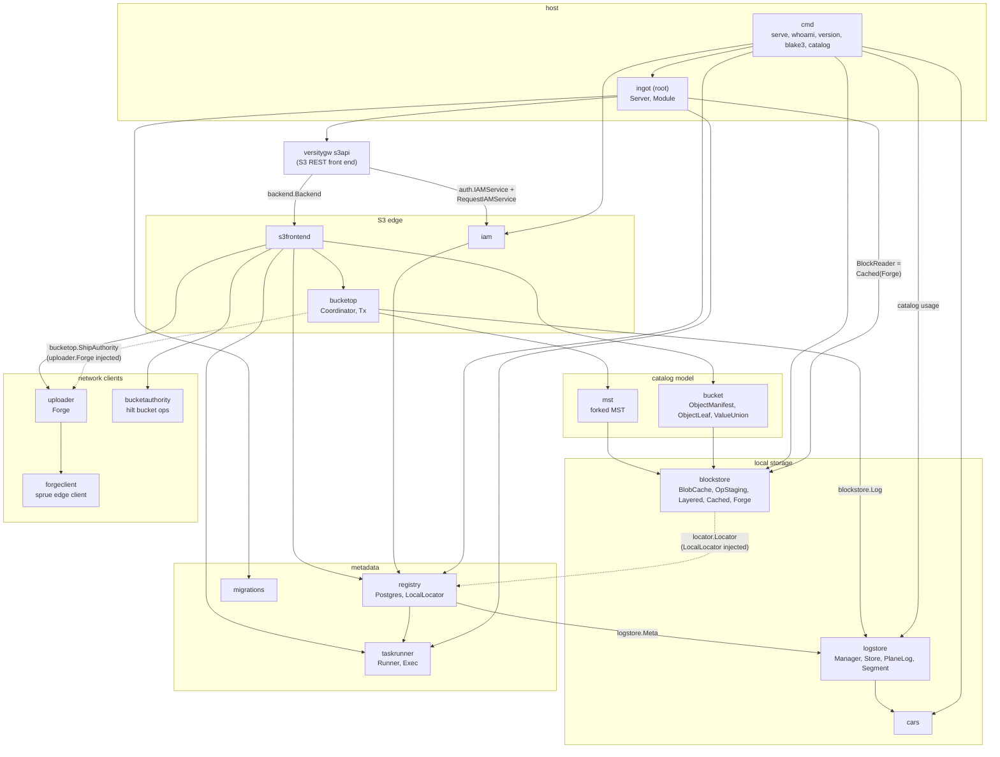

- `registry.Postgres` is one struct satisfying the registry seams
  (`Registry` plus the intent, location, inclusion, blob-ref, GC, multipart,
  park, and catalog usage stores) and `logstore.Meta`.
- `taskrunner` imports nothing else from ingot. `New` registers
  `s3frontend`'s handlers for every queue on the one runner
  `provideTaskRunner` builds, and `registry` returns the statements and task
  specs a handler commits with.
- `uploader.Forge` is one struct behind `Uploader`,
  `StreamingBodyUploader`, `DeferredBodyUploader`, and `BlobRemover`.
- `internal/testfakes` (test-only fakes), `tokenstore` (empty; only the
  dormant login paths would read it), `regionkey`, `tenantkey`, `revocation`,
  `blake3tree` and the `internal/` helpers are omitted. `blockstore/locator`'s indexer-backed
  locator compiles but is never injected.
- `cmd`'s `catalog usage` builds its own logstore walk, registry, Hilt
  authorization and Forge reader rather than going through the server.
- `iam` and the network tiers never import each other; they meet at
  `internal/reqscope` (the request-scoped proof store, drawn in
  [principals](#principals-and-proof-stores)).

Sources: the `go list` import graph, `module.go`, `server.go`,
`s3frontend/backend.go`. Review on package add/remove or `module.go` provider
changes.

## Two block routes: body blobs and catalog blocks

A write produces two kinds of blocks, and they reach Forge by different
routes. Body blobs travel synchronously, each as its own network object,
before the commit; catalog blocks (MST nodes, manifests, leaf blocks) commit
locally first and ship later, packed into shared CAR segments.

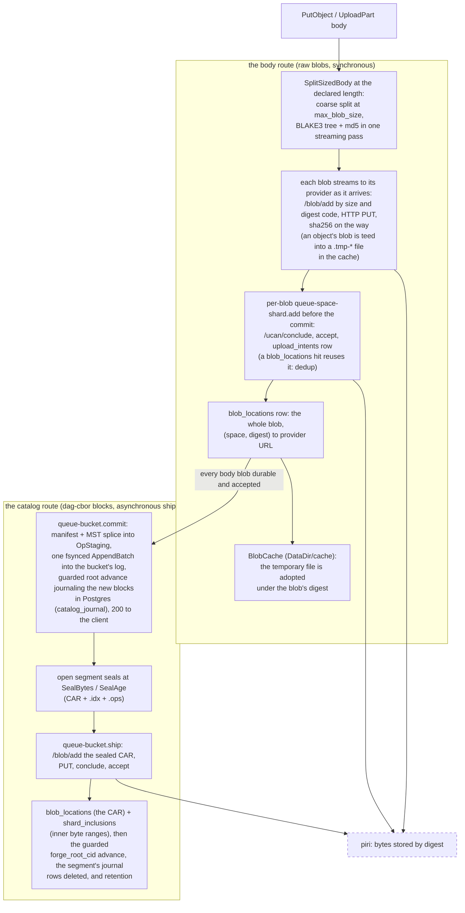

- The `200` means different things per route: body blobs are durable and
  accepted on Forge at ack; the catalog is fsynced locally and journaled in
  Postgres at ack, and becomes durable on Forge only when its segment ships
  (`forge_root_cid` lags `root_cid` until then). The journal is what puts the
  unshipped catalog in any copy of Postgres; shipping the segment deletes its
  rows.
- The ordering is the crash-safety invariant: the catalog route starts only
  after every body blob is durable, so a crash never leaves a catalog entry
  pointing at non-durable data.
- The network unit differs: a body blob is retrieved whole by its own digest
  (a `blob_locations` hit); catalog blocks share a CAR, so a network read
  resolves `shard_inclusions` to a byte range inside the shard.
- Reads mirror the split: `OpenBlob` (bodies) checks local disk (the
  cache) then network, skipping the log; `GetBlock` (catalog) checks
  local disk, log, then network
  (the [GetObject diagram](#getobject-version-resolution-local-tiers-network-retrieval)).
- Removal mirrors it too: bodies are reference-counted
  ([blob lifecycle](#blob-lifecycle-uploading-parked-accepted-released));
  superseded catalog blocks queue for a future collector
  ([catalog GC candidates](#catalog-gc-candidates-what-gets-remembered-for-removal)).
- A body streams: each blob is allocated by size
  and hash function (`/blob/add` with a digest code) and its envelope goes to
  the provider as it arrives, so the upload overlaps the body's arrival
  instead of following it. The digest is computed on the way; the put
  receipt reports it and the node checks it at accept. An upload service
  that cannot add by digest code fails the write.
- Multipart parts ride the body route with the conclude deferred (parked);
  the upload's `queue-multipart-upload-shard.accept` finishes it
  (the [multipart diagram](#multipart-upload-park-on-write-accept-in-the-background)).

Cross-references: [`architecture.md` §4](./architecture.md#4-the-catalog-layer),
[§5](./architecture.md#5-the-data-layer);
[`logstore/README.md`](../logstore/README.md).

Sources: `s3frontend/object.go` (ingestBody), `s3frontend/stream.go`,
`s3frontend/shardref.go` (runAdd), `s3frontend/bucketqueue.go` (runCommit),
`s3frontend/bucketship.go` (runShip),
`bucket/sized.go`, `blockstore/blobcache.go`,
`blockstore/staging.go`, `logstore/`, `uploader/forge.go`, `uploader/blob.go`,
`server.go` (newBucketFlushFunc). Review when these change.

## PutObject: stream and upload in the request, commit on the bucket queue

All network I/O runs in the request, before the commit. The commit is a
`queue-bucket.commit` task on the bucket's subject, run sync for the request,
so one change to a bucket runs at a time. It is a manifest write, an MST
splice, one fsynced `AppendBatch`, and a guarded root advance written with
the task. A `200` means the body is durable and accepted on the network, not
merely buffered.

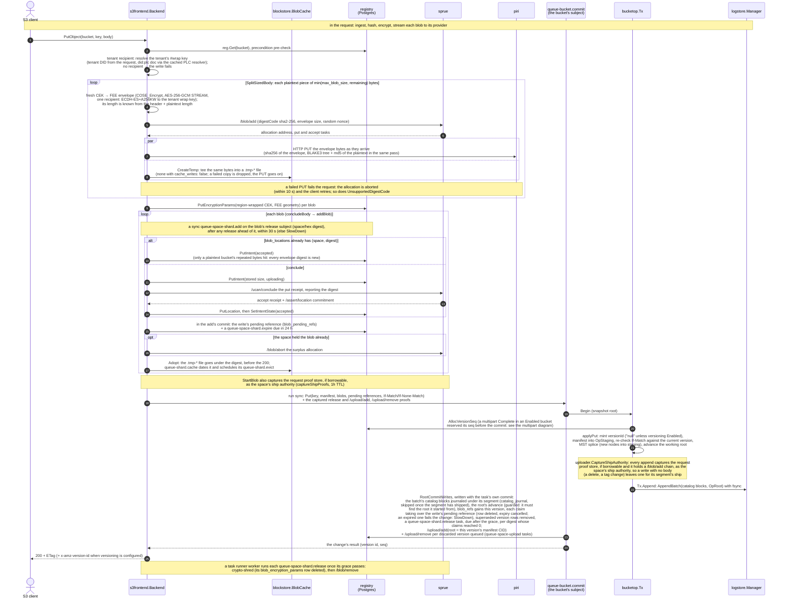

- A streamed blob whose body fails aborts its allocation at once. One a
  dying request leaves behind is never concluded, and the provider expires
  it within a day: an unaccepted blob counts toward no space's usage and is
  never served.
- Encryption makes the stored digest a ciphertext digest: **content dedup is
  gone for bodies** (fresh CEK per write ⇒ unique envelope), by design per
  the encryption RFC. Manifest spans, `Body.Size`, the BLAKE3 tree, md5 and ETag stay
  plaintext values; `upload_intents.Size` and `blob_locations.Size` are
  stored (envelope) sizes.
- The envelope's one COSE recipient is the tenant wrap key (kid = the key's
  fingerprint), the RFC's insurance copy: the tenant's private key alone
  recovers the plaintext. The IAM layer stashes the tenant DID from Hilt's
  authorize response on the request; `tenantkey` resolves the `#wrap` key
  from the tenant's did:plc document.
- The supersession rule (which prior version is retained, replaced, or
  discarded) is [`s3-versioning.md`](./s3-versioning.md) §5; the resulting
  storage shape is the [version tree](#per-key-version-storage-manifest-arm-leaf-arm-prev-tree).
- The claim ledger and the zero-claims release are the
  [blob lifecycle](#blob-lifecycle-uploading-parked-accepted-released).
- `CopyObject` commits the same Put change. Within one space its manifest
  pins the source's digests: no stream, no upload, claims incremented. Each
  source blob first takes a pending reference through a copy-mode
  `queue-space-shard.add`, which fails the copy with NoSuchKey unless the
  space has the blob located, and the copy's claims take them over; a source
  deleted and released after the adds leaves the copy's blobs referenced,
  and the copy commits. Across
  spaces (every bucket has its own) the CEK wrap bound to (space, digest)
  rules out sharing, so the source's plaintext streams through the decrypting
  read path into `ingestBody` and the copy gets its own blobs and claims. A
  source bucket owned by another tenant is `AccessDenied` before any key
  lookup (hilt refuses it when authorizing the request; ingot compares the
  tenant on the two bucket rows as well). The copy's ETag is the md5 of its
  bytes even for a multipart source.
- Supersession also records each replaced catalog block for future removal:
  the [catalog GC candidates](#catalog-gc-candidates-what-gets-remembered-for-removal)
  diagram shows every entry path.
- The `/upload/add` is what the upload service counts to report the space's
  object count: one content entry per committed version, keyed by the manifest
  CID. A discarded version retracts, a retained noncurrent one does not, and a
  delete marker registers like any other version — the same set AWS reports for
  `NumberOfObjects`. Best-effort, as the index publication is: the object is
  durable and the response must say so, so a failure logs and the count
  under-reports rather than failing a write that succeeded.
- The write does **not** call the upload service. It queues the change as a
  `queue-space-upload` task in the same transaction as the root's advance, and a
  worker sends it. The count is reporting data, so a Sprue round trip does not
  belong in a PUT, and a Sprue outage delays the count instead of failing
  writes or losing it.
- The task exists exactly when the version committed. The queue's subject is
  the space, so a space's changes run in commit order, and a batch takes only
  consecutive changes of one kind: up to 256 additions in one round trip, then
  the retractions after them in another. (A batch in ucantone's sense — many
  invocations, a receipt each.) Splitting by kind is needed because a container
  sorts its tokens bytewise, so the service may run a batch in any order, and a
  retraction sharing a batch with the addition it retires could overtake it and
  leave the root counted for good.
- A refused change is retried with backoff and holds its space, so a later
  change can never overtake it. Each change carries the delegation chain that
  authorizes it, captured from the request that committed the version, because
  the task has no request to borrow authority from.
- That chain has room to spare — hilt expires its delegation to the gateway at
  the next UTC midnight plus an async overhang, so even a change queued at
  23:59 has hours to be sent in. For a queue that outlasts that, the handler
  renews from the space's live authority, which a recent body upload with a
  borrowable store leaves behind, less any delegation a revocation has since
  named. A space that has gone quiet has none, and after
  `uploadRegistrationDeadLetterAfter` attempts the change fails for good: it
  stays in the queue as a failed task, out of the way of the space's later
  changes. The count is then short (or high) by that one change rather than
  frozen for the space. A bucket delete resends the space's failed retractions
  with its own authority before the space goes.

Cross-references: [`architecture.md` §7.1](./architecture.md#71-write-single-shot-putobject).

Sources: `s3frontend/object.go` (PutObject, ingestBody, concludeBody),
`s3frontend/shardref.go` (addBlob, runAdd, runExpire), `s3frontend/stream.go` (WriteSizedBlob), `s3frontend/localblobs.go`
(cacheWritten), `blockstore/blobcache.go`, `bucket/sized.go`, `uploader/stream.go`,
`s3frontend/copy.go` (CopyObject, copySourceBucket),
`s3frontend/version.go` (applyPut), `s3frontend/bucketqueue.go` (commit, runCommit, register),
`registry/bucketcommit.go` (RootCommitWrites),
`s3frontend/uploadqueue.go` (the queue-space-upload handlers), `bucketop/bucketop.go`,
`blockstore/staging.go`, `uploader/blob.go`, `uploader/forge.go`,
`uploader/upload.go`. Review when these change.

## GetObject: version resolution, local tiers, network retrieval

A read resolves the version through the MST, then serves each covering blob
from the first tier that has it: local disk (the cache), the
catalog log (catalog blocks only), then the network. Network resolution goes through the local locator
tables, never the indexing-service.

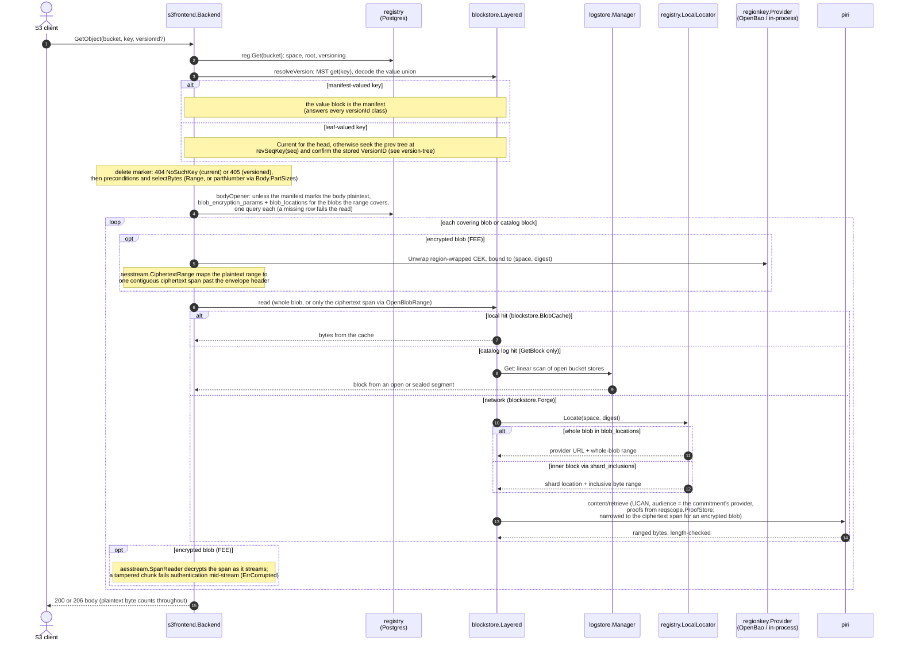

- `OpenBlob` (body blobs) checks local disk then network; only `GetBlock`
  (catalog blocks) consults the log tier, and only `GetBlock` is fronted by
  the `Cached` LRU.
- The indexer-backed locator (`blockstore/locator`) compiles but is never
  injected; `module.go` always wires `LocalLocator`.
- Manifest coordinates are plaintext: blob offsets, `Body.Size`, ETag and
  Content-Length never change with encryption. A blob's digest names the
  stored — for an encrypted blob, ciphertext — bytes; only the per-blob open
  translates between the two.
- The covering blobs come from the manifest's inline list, or from the one
  extent block whose offset range holds the read position (see the version
  storage diagram).
- HEAD needs no decryption at all (every value it reports is a plaintext
  manifest field).

Cross-references: [`architecture.md` §7.4](./architecture.md#74-read-getobject),
[§8](./architecture.md#8-retrieval-addressing-when-bodies-need-a-sharded-dag-index).

Sources: `s3frontend/object.go` (GetObject, HeadObject, selectBytes),
`s3frontend/version.go` (resolveVersion), `s3frontend/decrypt.go`
(bodyOpener, decryptingOpener), `bucket/chunker.go` (BlobRangeOpener),
`blockstore/layered.go`, `blockstore/blobcache.go`,
`blockstore/forge.go` (doRetrieve), `blockstore/cache.go`,
`registry/locallocator.go`, `logstore/manager.go` (Get). Review when these
change.

## Multipart upload: park on write, accept in the background

Parts upload to the provider at `UploadPart` and park there (durable,
unaccepted). Each upload's `queue-multipart-upload-shard.accept` task
concludes its parked parts in batches while the client is still uploading,
so `Complete` has only the last few left to accept and its cost stays flat
as the part count grows.

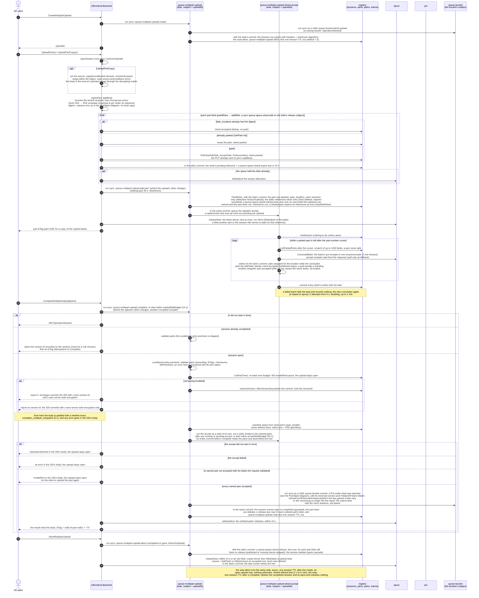

- A part re-upload and an abort queue a `queue-space-shard.release` task for
  every blob of theirs that is not still live in the session; the release
  itself decides whether the blob is free to go. Any reference in the space
  (a claim, a write's pending reference, a part of an in-flight session,
  counted in one statement by `CountReferences`) makes it stale and it does
  nothing; the session's teardown queues it again. A commit's claim
  publishes the blob's upload intent, so an abort releases only what was
  never committed, and the reap of a completed session releases nothing.
- A release can take a blob while an accept concludes it, when a part is
  replaced or dropped mid-conclude. Sprue decides the order: a released
  allocation refuses the accept, and an accepted blob refuses `/blob/abort`,
  which the release then follows with `/blob/remove`. The release deletes
  the park and location rows in its commit, so the accept's swap finds no
  park and records nothing for a blob a release took. The swap matches the
  park's `/blob/add` task, so a later park of the same bytes stays for its
  own conclude, and a part is marked accepted only while its row names the
  blobs the accept read, all located.
- Ingot treats a `/blob/remove` receipt as final. If sprue registers an
  accepted blob only after a remove that arrived earlier, that window is
  sprue's to fix, and Ingot does not guard it.
- A part is written only while its session is open, in the statement that
  checks the state. The add-part runs on the upload's subject, so no
  Complete or Abort runs beside it. One that ran first leaves the upload not
  open, the add-part answers NoSuchUpload, and the upload expires its pending
  references at once, which releases the blobs nothing else references
  (`dropRefsNow`).
- A blob with neither a park nor a location when the accept reaches it has
  gone from its provider. The accept leaves its part `parked`, and Complete
  answers `InvalidPart`; nothing keeps a part's bytes to upload them again.
- Complete reports its response headers through versitygw's
  `CompleteMultipartUploadReportingHeaders` before it accepts the parts,
  and the response commits to 200 at the report, as S3's does. A reserved
  version id is binding, and a Complete that reported none commits only a
  null version, so the client always learns the version it created
  ([`s3-versioning.md`](./s3-versioning.md) §5.1).

Cross-references: [`architecture.md` §7.2](./architecture.md#72-multipart),
[§7.3](./architecture.md#73-one-change-per-upload-the-abortcomplete-race).

Sources: `s3frontend/multipart.go` (all verbs, ingestPart, parkBlobs,
acceptRequested, sessionReleases), `s3frontend/multipartqueue.go`
(runCreateUpload, runAddPart, runAbort, runReap), `registry/multipartqueue.go`
(PartWrites, CompletedSession),
`s3frontend/version.go` (reserveVersion, applyPut), `s3frontend/bucketqueue.go` (putPreCheck),
`s3frontend/acceptor.go` (runAccept, acceptBatch), `registry/accept.go`,
`s3frontend/stream.go`,
`s3frontend/shardref.go` (addBlob, runAdd, dropRefsNow),
`s3frontend/releasequeue.go` (runRelease, releaseNow),
`s3frontend/uploadpartcopy.go`, `registry/stores.go`. Review when these change.

## Part states: the acceptance queue

A part row's `state` is the upload's acceptance queue. The accept marks a
part `accepted` only while its row still names the blobs the accept read, so
it never moves a row a later upload of the same part number replaced.

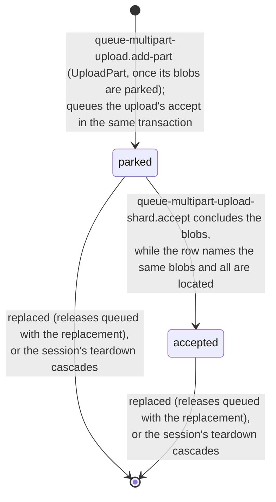

- A part with a blob that has neither a park nor a location stays `parked`:
  its blob has gone from its provider, and Complete refuses the part
  (`InvalidPart`), since nothing keeps a part's bytes to upload them again.
- A replacement queues releases for the blobs the replaced row named and the
  new one does not, in the same transaction. Each is stale while a part, a
  claim or a pending reference in the space still names its blob. The
  request runs them itself when it can, rather than leave them to the
  runner's workers.
- Complete requires every part it names to be `accepted` before the commit.
  It runs the accept for those parts as a task of its own (parts it omits
  cannot fail it), answers an accept that cannot start within 30 s with a 409 that
  botocore clients treat as final, and fails with the accept's error when
  the accept fails. A failed batch fails the whole accept, which records
  nothing.
- Rows from before migration 00030 are `parked` or `accepted` and have no
  `span_lengths`; Complete derives their lengths per blob.

Sources: `registry/stores.go` (Part* consts), `registry/stores_postgres.go`
(ListParkedParts, OldestParkedPart), `registry/multipartqueue.go` (PartWrites),
`registry/accept.go`, `s3frontend/acceptor.go`, `s3frontend/multipart.go`
(ingestPart, acceptRequested), `migrations/sql/00030_part_accept_queue.sql`,
`migrations/sql/00033_task_runner.sql`. Review when these change.

## Session states: open and completed

Every change to an upload runs as a task on `queue-multipart-upload`, with
the upload ID as its subject, so a Complete and an Abort never overlap and
no part lands beside either.

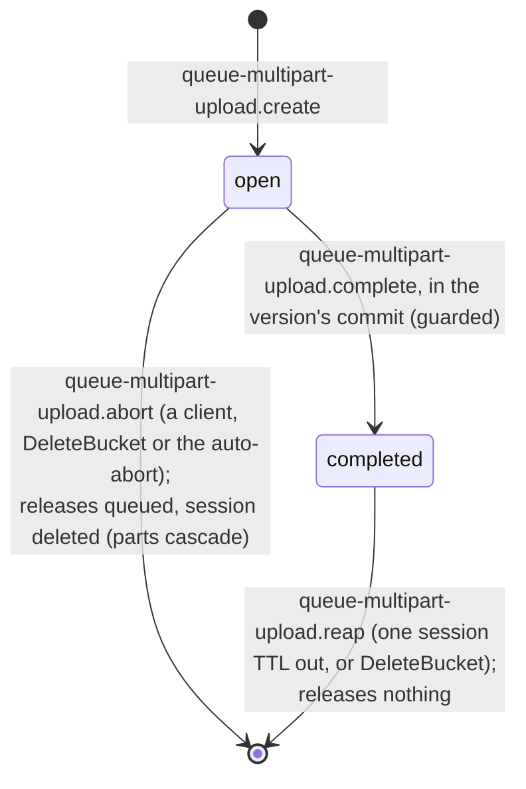

- A Complete waits up to 10 s (`replayWaitBudget`) for the upload's other
  changes, another Complete included, before it reports anything; past
  that it answers `OperationAborted`, a 409. A Complete that runs after
  another one committed replays the ETag and version id recorded on the
  session, and skips the conditional-write precheck. A Complete after an
  Abort finds no session and answers `NoSuchUpload`.
- A Complete that fails before its commit leaves the upload open for a
  retry.
- The Complete's commit moves the session from `open` to `completed` in the
  same transaction as the version, guarded on it still being open.
- `ListParts` and `Abort` reject any non-`open` session as `NoSuchUpload`;
  `Complete` alone accepts `completed`, for idempotency. The auto-abort
  leaves a completed or missing upload alone.
- DeleteBucket aborts each open upload and reaps each completed one from
  the request, after `queue-bucket.close`.

Sources: `s3frontend/multipart.go`, `s3frontend/multipartqueue.go`,
`s3frontend/bucketqueue.go` (putPreCheck), `registry/multipartqueue.go`
(CompletedSession, DeletedSession, ReapedSession). Review when these change.

## Blob lifecycle: uploading, parked, accepted, released

Dedup stores bytes once; the claim ledger lets them be deleted once. Intents
track the disk-and-network state of each digest; `blob_refs` counts which
versions still reference it.

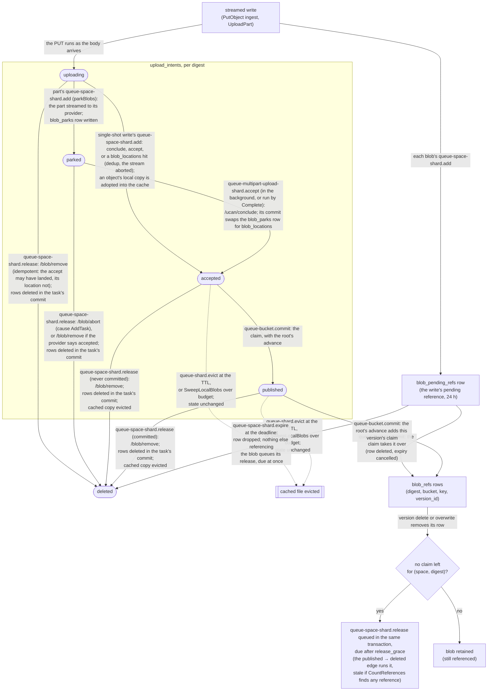

- `published` is written with the blob's first reference claim and never
  changes until the blob's release, which evicts the cached copy and removes
  the intent as it does for a never-committed blob. `blob_parks` is a
  presence machine (a row exists while a conclude is owed), not a state
  column.
- An object's blob is teed into a `.tmp-*` file in the cache as it streams
  (`BlobCache.CreateTemp`). Once its location and `accepted` state are both
  recorded, the write adopts the file under its digest (`BlobCache.Adopt`)
  before the PUT answers, and queues a `queue-shard.cache` task that dates
  the file and schedules a `queue-shard.evict` for `cache_ttl` later. A copy
  that could not be written or adopted is not cached. With
  `cache_writes: false` no copy is kept, and a multipart part never keeps
  one.
- Eviction (the dotted edges) is orthogonal to the state and touches only
  the cache. A read from the cache with less than half its `cache_ttl` left
  runs `queue-shard.cache` again, which replaces the pending eviction with a
  later one. `SweepLocalBlobs` runs every 30s and, when the cache, writes in
  progress included, is over `local_blob_max_bytes`, evicts cached files through sync
  `queue-shard.evict` tasks, oldest
  modification time (last renewal) first, down to 90% of the budget. The
  intent keeps its row and state; reads fall through to the network tier.
  Writes in progress are never evicted. A blob's release queues the
  eviction of its cached copy unless another space holds an intent for the
  digest.
- Digests present in both the old and new version sets never churn: the new
  generation's claim lands before the old one's drops in the same
  transaction, so the digest keeps a claim throughout and no release is
  queued.
- Parked-blob reclamation is guarded: a digest live in another session, part,
  committed object or write's pending reference is left alone.
- A write's pending reference is taken by its `queue-space-shard.add` on the
  blob's release subject, which never overlaps a release of the blob. A
  release that fails retries holding the subject, so an add behind it waits
  and then finds the blob unlocated and concludes its own stream. A write of
  a deleted object's bytes (plaintext bucket) while that object's release is
  within its reader grace keeps the blob: the release finds the reference
  and is stale.
- A same-space copy takes a pending reference to each source blob through a
  copy-mode `queue-space-shard.add`, which fails the copy with NoSuchKey
  unless the space has the blob located; its claims take the references
  over, so a source deleted and released after the adds leaves the copy's
  blobs referenced.

Cross-references: [`architecture.md` §5](./architecture.md#5-the-data-layer),
[`s3-versioning.md`](./s3-versioning.md) §8.

Sources: `registry/stores.go` (state consts), `s3frontend/object.go`
(ingestBody, addClaims, dropClaims), `s3frontend/localblob_sweep.go` (SweepLocalBlobs),
`s3frontend/stream.go` (WriteSizedBlob), `s3frontend/localblobs.go` (cacheWritten),
`blockstore/blobcache.go` (CreateTemp, Adopt), `s3frontend/shardqueue.go`
(queue-shard.cache, queue-shard.evict),
`s3frontend/multipart.go`
(parkBlobs, sessionReleases),
`s3frontend/acceptor.go`, `registry/accept.go`, `s3frontend/releasequeue.go`
(runRelease), `s3frontend/shardref.go` (runAdd, runExpire),
`registry/stores_postgres.go` (CountReferences, PendingRefByExpiry),
`registry/bucketcommit.go` (claimWrites, dropWrites), `registry/multipartqueue.go`
(refWrites),
`registry/release.go` (ReleasedRows, ReleasedIntent, PendingRef),
`uploader/blob.go` (ConcludeBlobs,
AbortBlob, RemoveBlob). Review when these change.

## Per-key version storage: manifest arm, leaf arm, prev tree

Every catalog value block is a keyed union naming its own format. A key holds
its manifest directly until its first retained supersession, then gains an
`ObjectLeaf` and keeps it for the rest of its life.

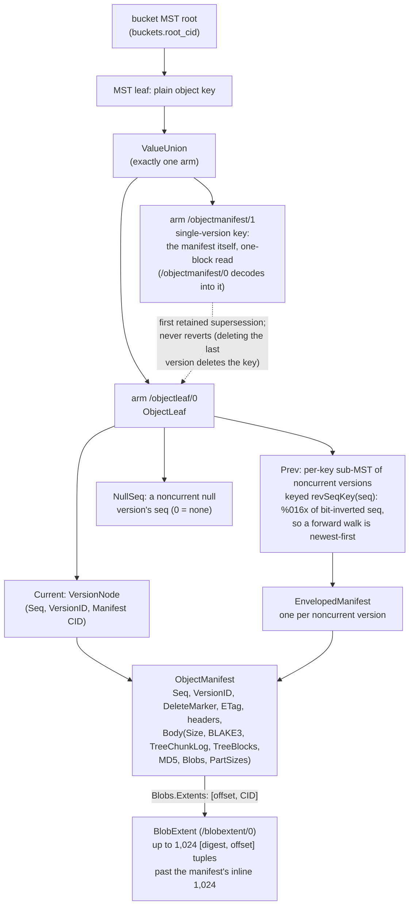

- At most one null version exists per key; it may sit anywhere in the stack,
  and `NullSeq` locates (and lets a new null evict) a noncurrent one.
- The version token is a ULID whose low bytes embed the seq, but the embedded
  seq is only a locator hint: resolution always confirms the stored
  `VersionID`.
- Deleting the current version promotes the prev-tree head into a new leaf
  (clearing `NullSeq` when the promoted seq was the null); deleting the last
  version deletes the key.
- The bucket versioning state itself is three values, set by
  `queue-bucket.set-versioning` on the bucket's subject: `unversioned` moves
  to `enabled` or `suspended`, which then toggle; there is no path back to
  `unversioned`.
- Blocks this tree sheds (replaced leaf blocks, discarded manifests) are
  recorded for future removal; the entry paths are the
  [catalog GC candidates](#catalog-gc-candidates-what-gets-remembered-for-removal)
  diagram.

Cross-references: [`s3-versioning.md`](./s3-versioning.md) (the full design:
value union §2.1, prev tree §2.2, token §3, write rule §5, deletes §7);
[`architecture.md` §4](./architecture.md#4-the-catalog-layer) keeps the ASCII
manifest figure this complements.

Sources: `bucket/leaf.go`, `bucket/manifest.go`, `s3frontend/version.go`
(mintVersionID, revSeqKey, applyPut, applyDeleteVersion),
`s3frontend/bucketadmin.go` (runSetVersioning). Review when
`bucket/` types change (and re-run `make gen`).

## Catalog GC candidates: what gets remembered for removal

`gc_candidates` is the memory of the catalog collector to come: every write
that supersedes a catalog block records that block's CID here, with the
`queue-bucket.commit` that sheds it, so nothing the tree sheds is ever
forgotten. Nothing
consumes the table yet.

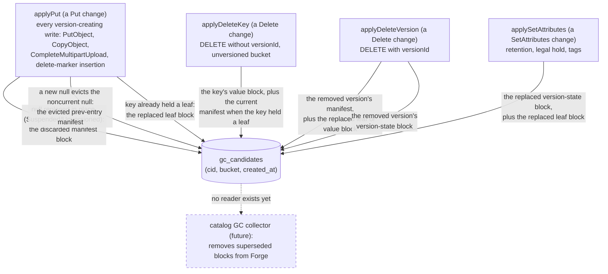

- Recording is mandatory, never best-effort: the inserts are written with the
  root's advance in the task's commit, so a failed insert fails the whole
  commit and the root does not move. A change that fails on its own terms
  drops the candidates it recorded along with the rest of its work.
- A retained supersession queues only the replaced **leaf block**; the old
  manifest is not queued because it lives on as a prev-tree entry. Only
  blocks nothing references anymore land here.
- As built, the table holds superseded **value blocks** (manifests and leaf
  blocks) and version-state blocks (a version's lock and tags). Interior MST
  path nodes rewritten by a splice are not recorded;
  [`architecture.md` §4](./architecture.md#4-the-catalog-layer) scopes the
  eventual collector to those as well.
- The body bytes a removed version referenced are handled separately, by the
  claim ledger in the
  [blob lifecycle](#blob-lifecycle-uploading-parked-accepted-released):
  `gc_candidates` remembers catalog blocks, `blob_refs` counts body blobs.

Cross-references: [`architecture.md` §4](./architecture.md#4-the-catalog-layer),
[`s3-versioning.md`](./s3-versioning.md) §7.

Sources: `s3frontend/version.go` (applyPut supersession,
applyDeleteVersion), `s3frontend/object.go` (applyDeleteKey),
`s3frontend/objectlock.go` (applySetAttributes), `bucketop/bucketop.go`
(AddGCCandidate, Mark, Restore), `s3frontend/version.go` (pruneVersionState),
`registry/bucketcommit.go`
(RootCommitWrites). Review when these change.

## Principals and proof stores

The agent signs every outbound invocation, but the authority to act on a
space arrives per request: hilt re-delegates the access key's grant to the
agent, the IAM layer caches it per access key, and `internal/reqscope`
carries it into the write and read paths.

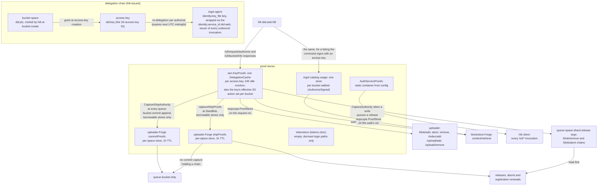

- The piri provider DID is never configured: retrieval audiences come from
  the `/assert/location` commitment each read resolves.
- Every authenticated S3 request carries a proof store: versitygw's root
  account is disabled, so no access-key auth path skips the hilt-backed IAM
  lookup. `/health` and the DID document are outside the S3 auth chain, and a
  rejected access key never receives one.
- The ship authority holds a request's store past the request only when the
  IAM layer marked it borrowable (`reqscope.BorrowableKey`, read through
  `reqscope.BorrowableProofStore`), which it does for the key's own
  `DelegationCache` only. A request authorized off a response carrying a
  revoked delegation spends a store of its own, marked not borrowable.
- A revocation drops the key's store from `KeyProofs`, but a captured store
  stays in use: no chain it assembles uses a delegation the revocation named,
  so the spaces its other grants cover keep shipping.
- Every write captures the ship authority when it commits, so a segment,
  sealed seconds after its writes, ships under a fresh capture. That capture
  is kept apart from the upload's: hilt grants each catalog-changing
  operation the ship's commands, but a narrower key's grant (tagging,
  retention) lacks the release, abort and registration commands the
  upload's capture also serves. The ship uses the commit's capture only when
  it holds a `/blob/add` chain for the space (an older key's grant, or an
  expired or revoked delegation, may not), and the upload's otherwise. Both
  last an hour and live in memory: a segment whose ship keeps failing past
  that, or across a restart, has no authority until the bucket's next
  write.
- Each access key gets its own `DelegationCache`, so a proof chain can never
  assemble across keys.
- `ingot catalog usage` is a command, not the daemon, and gets its stores
  another way: with an access key from its environment it signs a
  ListObjectsV2 of each bucket it must read from Forge, has hilt authorize it
  as it would a request the gateway serves, and keeps the delegations for that
  bucket's walk alone. The daemon holds no tenant's secret, so it has no such
  path.
- The same store holds the effective S3 action set hilt reported for the key
  on each bucket, expiring with the keys and the tenant (next UTC midnight
  plus clock skew). One invalidation therefore drops the chains and the set
  together. The set is what the fast path enforces: several S3 actions map to
  the same Forge commands, and `s3:PutObject`'s commands are a superset of
  `s3:GetObject`'s, `s3:ListBucket`'s and `s3:AbortMultipartUpload`'s, so a
  chain probe alone would let a put-only key read and abort on the bucket, or
  read a copy's source.
- A copy's source and the headers that add a permission to a write (a lock
  or tags on the version it creates) are decided from headers, and a
  DeleteObjects on its body, which iam attaches for the operations hilt
  names (`Operation.ReadsBody`) and no other. Hilt's `RequirementsFor`
  refuses a header the signature does not cover or a body it does not bind,
  as hilt itself does, so the fast path decides nothing from such a
  request: it goes to hilt, which refuses it as `UnsignedHeader` or
  `InvalidBody`.

Cross-references: [`architecture.md` §9](./architecture.md#9-the-system-contract-piri--sprue--indexer).

Sources: `iam/service.go`, `iam/keyproofs.go`, `iam/proofcache.go`,
`internal/reqscope/reqscope.go`, `cmd/catalog.go` (forgeSegments),
`uploader/forge.go` (shipProofs, captureShipProofs, CaptureShipAuthority),
`uploader/stream.go` (StartBlob), `bucketop/bucketop.go` (Tx.Append),
`s3frontend/releasequeue.go` (releaseAuthority, withReleaseAuthority),
`module.go`, `config/config.go` (auth_service fields).
Review when these change.

## Request authorization and proof capture

Every request is authorized against hilt (or its cached delegations), and
the proofs captured here are what the rest of the request spends. Versitygw's
root account is disabled, so no access key bypasses this path. The bucket
policy operations (GET, PUT and DELETE on `/{bucket}?policy`) take it too,
through versitygw's own controllers; the backend (`s3frontend/policy.go`)
then forwards the signed request to `/s3/bucket/policy`, where hilt
authenticates and authorizes it again and keeps the document.

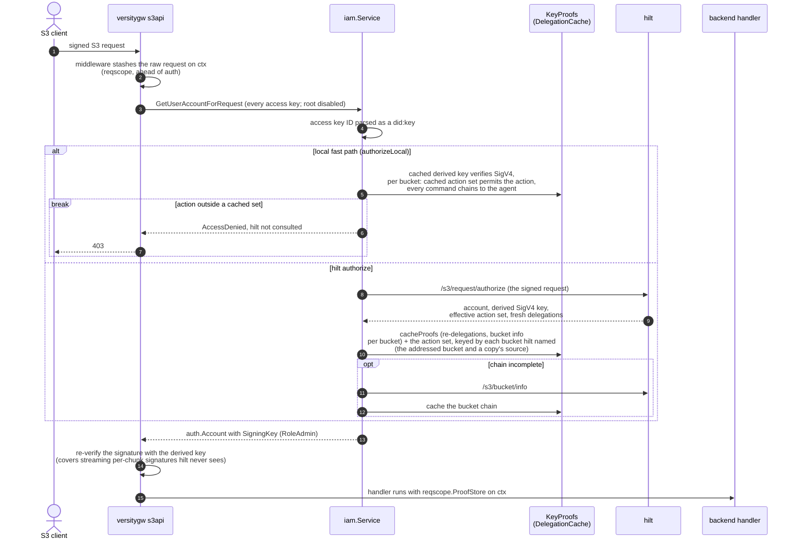

- The fast path has three outcomes: authorized, refused, or undecided. It
  refuses only on a cached action set that excludes the action a bucket
  needs — hilt's own answer for that key and bucket, so re-asking would
  repeat it (access keys are immutable; a deleted key's revocations clear
  the store). Everything else undecided (no cached set for a bucket, an
  expired one, an operation that maps to no Forge command) goes to hilt,
  whose response refills the caches.
- `RoleAdmin` is deliberate: authorization already happened (at hilt or the
  fast path), so versitygw's role and ACL layers must defer entirely.
- Authorize failures map to S3 errors in `mapAuthError`; unrecognized errors
  stay 500-class on purpose.
- The signing key never leaves hilt as a secret: ingot receives a derived
  SigV4 key per request (the versitygw fork's `auth.Account.SigningKey`).
- A policy document reaches hilt only after versitygw's PutBucketPolicy
  controller has validated its AWS shape; `iam.Service.GetUserAccount`
  answers that validation's principal lookups for any well-formed user ARN.
  GetBucketPolicy forwards only a signed GET ?policy: versitygw's own access
  checks call it too and get the stub answer, so versitygw never evaluates a
  policy. A hilt rejection renders through the same `mapAuthError` mapping;
  a gateway middleware (`policyHeaders`) adds the response ETag the backend
  leaves in a reqscope holder, and a GET's JSON content type.

Sources: `iam/service.go` (GetUserAccountForRequest, authorizeLocal,
cacheProofs, mapAuthError), `iam/proofcache.go` (PutPermissions, Permits),
`server.go` (buildS3API middleware, policyHeaders), `s3frontend/policy.go`.
Review when `iam/`, `s3frontend/policy.go` or the hilt client changes.

## Postgres schema as migrated

Everything relational lives in the `ingot` schema; manifests and MST nodes
are content-addressed blocks in the catalog log, not rows, apart from the
catalog journal's copy of those not yet shipped. Attributes here
are trimmed to keys, states, and the columns other diagrams reference; the
full DDL is `migrations/sql/`, annotated in
[`architecture.md` Appendix C](./architecture.md#appendix-c--postgres-schema-the-ingot-schema),
which also covers the task runner's per-queue tables (left out here).

```mermaid
erDiagram
    buckets {
        text name PK
        bytea root_cid "committed MST root"
        bytea forge_root_cid "root durable on Forge"
        text space "Forge space DID"
        text tenant "owning tenant DID"
        text versioning "unversioned, enabled, suspended"
        text encryption "AES256, none; NULL = unconfigured, encrypts"
        bigint next_version_seq
        boolean closing "set by DeleteBucket's queue-bucket.close"
    }
    segments {
        bigint seq PK "from segment_seq"
        text plane "'data' arm is dead"
        text state "open, sealed"
        text bucket
        bytea sha256
        bigint shipped_at
        bytea index_digest
        bigint dead_bytes "dead on arrival; NULL = unmeasured"
        bigint retired_at
    }
    segment_op_roots {
        bigint seq PK, FK
        int seq_within PK
        text bucket
        bytea root_cid
    }
    catalog_journal {
        bigint seq PK "segment the block went into"
        bytea cid PK
        text bucket FK
        bytea data "the block, until its segment ships"
        timestamptz created_at
    }
    blob_refs {
        bytea digest PK
        text bucket PK
        text object_key PK
        text version_id PK
        text space "claim index (space, digest)"
    }
    blob_pending_refs {
        uuid add_task PK "the queue-space-shard.add that took it"
        uuid expire_task UK "the queue-space-shard.expire due at the deadline"
        text space
        bytea digest
        timestamptz deadline "24 h after the add"
    }
    upload_intents {
        text space PK "the upload's space: one cached file, an intent per space"
        bytea digest PK
        bigint size
        text state "uploading, parked, accepted, published (claimed by a commit)"
        text bucket
        timestamptz updated_at "last state change: dates a stalled upload"
    }
    blob_locations {
        text space PK
        bytea digest PK
        text provider "provider DID"
        text url
        bigint size
    }
    blob_encryption_params {
        text space PK
        bytea digest PK "ciphertext blob multihash"
        bytea region_wrapped_cek "never the raw CEK; deleting the row crypto-shreds the blob"
        text region_key_version
        bigint header_len "the ciphertext starts here"
        bytea aad "COSE Enc_structure; its protected header holds the base nonce and chunk size"
    }
    shard_inclusions {
        text space PK
        bytea digest PK "inner block multihash"
        bytea shard_digest
        bigint range_start
        bigint range_end "inclusive"
    }
    blob_parks {
        text space PK "the allocation's space"
        bytea digest PK
        bytea add_task
        bytea accept_task
        bytea put_invocation
        bigint size
    }
    multipart_sessions {
        text upload_id PK
        text bucket
        text space "the bucket's space, required: the subject of every release of the session's blobs, never resolved from the bucket name"
        text object_key
        text state "open, completed"
        timestamptz state_changed_at "set at create and by Complete"
        boolean plaintext "store parts as received; decided at create"
        text checksum_algorithm
    }
    multipart_parts {
        text upload_id PK, FK
        int part_number PK
        bytea etag_md5
        bytea blob_digests "ordered array"
        bigint span_lengths "each blob's span in the object, bytes before encryption (digests are of the stored blob); NULL before 00030"
        text checksum
        text state "parked, accepted: the upload's accept queue"
    }
    multipart_part_trees {
        text upload_id PK, FK
        int part_number PK, FK
        bigint tree_offset "object offset the part's BLAKE3 tree was hashed at (assumed by UploadPart)"
        smallint chunk_log "block size of blocks, base-2 exponent of chunks"
        bytea nodes "the part's aligned subtrees (blake3tree.EncodeSubtrees)"
        bytea blocks "the part's blocks at chunk_log; up to 320 KiB for a 5 GiB part"
        bytea head "bytes before the part's first chunk boundary (< 1 KiB)"
        bytea tail "bytes after its last chunk boundary (< 1 KiB)"
        bytea root "the part's own BLAKE3 hash, when hashed at offset 0"
    }
    gc_candidates {
        bytea cid PK "superseded MST node"
        text bucket
    }
    revocation_cursor {
        boolean id PK "single-row latch"
        timestamptz recorded_at "resume point in the revocation stream"
    }

    segments ||--o{ segment_op_roots : "ON DELETE CASCADE"
    multipart_sessions ||--o{ multipart_parts : "ON DELETE CASCADE"
    multipart_parts ||--o| multipart_part_trees : "ON DELETE CASCADE; deleted by Complete once the object commits"
    buckets ||--o{ catalog_journal : "ON DELETE CASCADE"
    segments ||..o{ catalog_journal : "by seq, deliberately no FK"
    buckets ||..o{ segments : "by bucket name, no FK"
    buckets ||..o{ blob_refs : "by bucket name, no FK"
    blob_locations ||..o{ shard_inclusions : "by shard_digest"
    blob_locations ||..o| blob_encryption_params : "by (space, digest), deliberately no FK"
    multipart_parts ||..o{ blob_parks : "digests in blob_digests"
```

- The four solid relationships are the schema's only real foreign keys;
  dashed ones are soft joins the code performs. `revocation_cursor` stands
  alone. `blob_pending_refs` joins nothing: a release counts its rows with
  the `blob_refs` claims and the open sessions' parts by (space,
  digest).
- `catalog_journal` has no foreign key to `segments` on purpose: when a
  segment's CAR is missing from disk, recovery rebuilds its journaled blocks
  into new segments and moves the rows onto them, then deletes the lost row if
  it was open (and retires it if it was sealed).
- `gc_candidates` is write-only (no reader exists yet; its entry paths are the
  [catalog GC candidates](#catalog-gc-candidates-what-gets-remembered-for-removal)
  diagram); `segments.plane`
  still CHECK-allows the deleted `data` arm.
- Session rows also carry the passthrough HTTP headers and checksum columns
  Complete writes into the manifest; intent and location rows carry
  timestamps. See the DDL for the full column lists.

Cross-references: [`architecture.md` Appendix C](./architecture.md#appendix-c--postgres-schema-the-ingot-schema)
(the annotated DDL).

Sources: `migrations/sql/*.sql`. Review whenever a migration is added.

## DeleteBucket teardown order

Teardown crosses every seam in order: close the bucket, unwind in-flight
multipart, prove the bucket empty again, commit its root empty, quiesce the
log, release every network registration, then delete at hilt and locally.
The request runs `queue-bucket.close`, then each upload's abort or reap,
then a `queue-bucket.delete` task, all sync on the bucket's subject except
the multipart tasks, so no commit or ship of the bucket runs beside the
delete. The multipart tasks run from the request because
`queue-multipart-upload` is above `queue-bucket` in the runner's order.

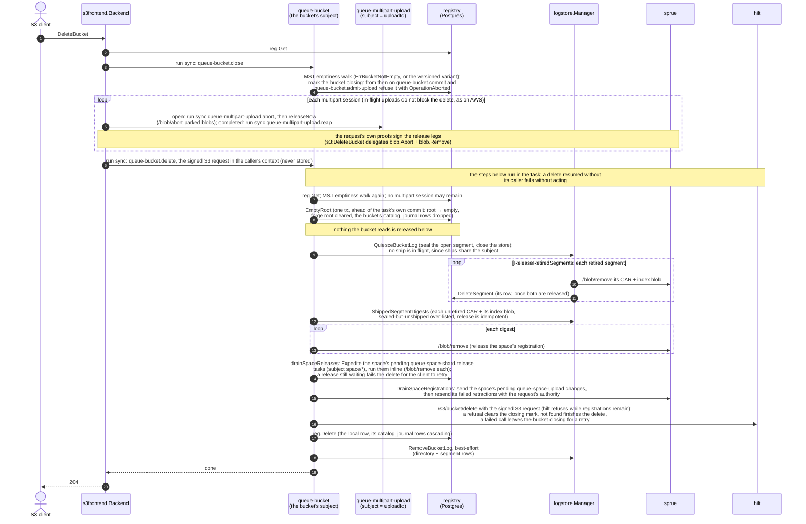

- The log seams (`QuiesceBucketLog`, `ReleaseRetiredSegments`,
  `ShippedSegmentDigests`, `RemoveBucketLog`) are type-asserted on `blockstore.Log`: a plain `Store`
  without them silently no-ops, which is the trap this diagram documents.
- A failure after the root is committed empty (hilt refusing, a release
  erroring) leaves the bucket functional: it lists empty, the closed store
  reopens lazily on the next write, and a retried delete starts over,
  except for the retired segments already released, whose rows are gone.
  The quiesce leaves the last segment sealed and unshipped until that next
  write; its journal rows went with the root.

Sources: `s3frontend/bucket.go` (DeleteBucket, runDeleteBucket),
`s3frontend/bucketadmin.go` (runCloseBucket, runAdmitUpload),
`s3frontend/bucketqueue.go` (bucketSpec), `s3frontend/multipartqueue.go`
(abortUpload, runAbort, reapNow, runReap),
`s3frontend/releasequeue.go` (drainSpaceReleases),
`s3frontend/uploadqueue.go` (DrainSpaceRegistrations),
`logstore/manager.go`. Review when these change.

## Package-to-diagram map

The review table for changes: find the package you touched, re-check the
listed diagrams (each diagram's `Sources:` footer names its exact files).

| Package / file | Diagrams to review |
|---|---|
| `s3frontend/object.go` | put, get, blob-lifecycle, version-tree, gc-candidates, delete-bucket |
| `s3frontend/version.go` | put, get, multipart, blob-lifecycle, version-tree, gc-candidates |
| `s3frontend/multipart.go`, `multipartqueue.go`, `registry/multipartqueue.go` | multipart, part-states, multipart-states, blob-lifecycle, delete-bucket |
| `s3frontend/acceptor.go`, `registry/accept.go` | multipart, part-states, blob-lifecycle |
| `s3frontend/releasequeue.go` | put, multipart, part-states, blob-lifecycle, delete-bucket |
| `s3frontend/shardref.go` | put, multipart, blob-lifecycle |
| `s3frontend/uploadqueue.go` | put, delete-bucket |
| `s3frontend/shardqueue.go`, `localblobs.go`, `localblob_sweep.go` | put, blob-lifecycle |
| `s3frontend/stream.go` | put, multipart, block-routes, blob-lifecycle |
| `s3frontend/bucket.go` | context, delete-bucket |
| `s3frontend/bucketqueue.go`, `bucketchanges.go`, `bucketadmin.go`, `bucketship.go` | put, multipart, gc-candidates, delete-bucket, logstore-pipeline |
| `bucketop/` | put, get, delete-bucket, packages, principals |
| `taskrunner/` | packages, put, multipart, multipart-states, delete-bucket |
| `blockstore/` | get, packages, block-routes; `forge.go` also context, principals |
| `registry/` | schema, get, blob-lifecycle, logstore-pipeline |
| `logstore/` | logstore-pipeline, segment-states, get, block-routes, delete-bucket |
| `uploader/`, `forgeclient/` | context, put, multipart, principals, logstore-pipeline, block-routes |
| `iam/`, `internal/reqscope/` | principals, authorize, context |
| `cmd/catalog.go` | packages, principals |
| `bucket/`, `mst/` | version-tree, put, get |
| `migrations/sql/` | schema, plus any state diagram naming a changed CHECK |
| `module.go`, `server.go`, `config/` | packages, context, logstore-pipeline; `server.go` also authorize and multipart |
| `s3frontend/policy.go` | context, authorize |
